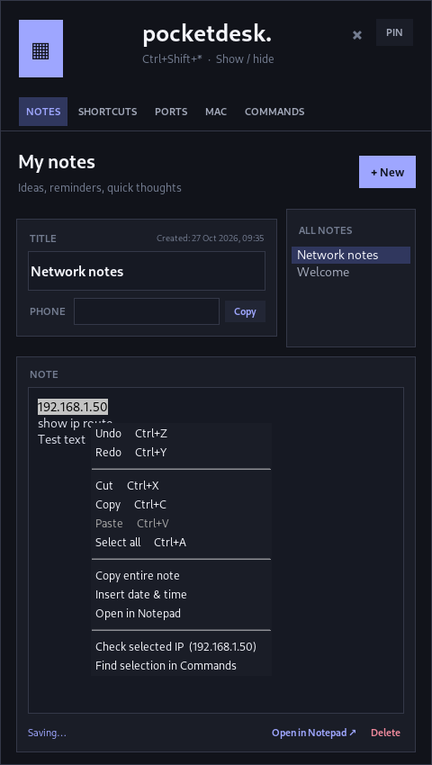
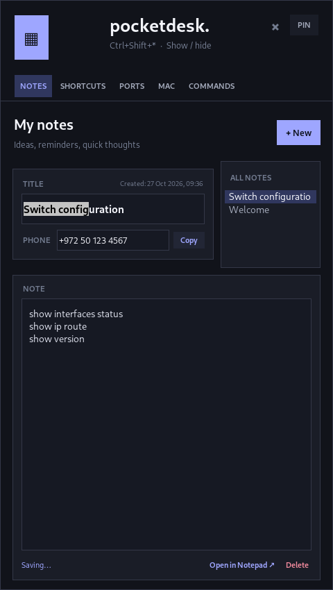

# PocketDesk

**A lightweight Windows system-tray toolbox: notes, quick shortcuts, TCP port checks, MAC vendor lookups, and a searchable CLI command helper.**



PocketDesk lives beside the Windows clock. Click the tray icon or press **Ctrl + Shift + \*** to show and hide it. All five panels use the same compact, tall popup; no cloud account or telemetry is required.

**Current version: 1.16** · Windows 10/11 · Python 3.10+ · local-first

## Features

| Tab | What you can do |
| --- | --- |
| **Notes** | Autosaved plain-text notes, titles, optional phone number with a Copy button, original creation timestamp, and an All Notes picker above a full-width editor. |
| **Shortcuts** | Save and launch websites, local files, or folders. Drag an item onto the drop zone to prefill a draft; review the suggested name and target before saving. |
| **Ports** | Test a target IPv4/IPv6 address against one TCP port or a selected list/range, view connection outcomes, and export CSV. |
| **MAC** | Paste many MAC addresses, identify assigned vendors using locally cached IEEE CSV datasets, and export results. |
| **Commands** | Filter by device, category, command syntax, or English/Hebrew description. Edit before copying, save favorites, view recent commands, and add/edit/delete custom commands. |

### Notes: full-width editor with a smart right-click menu



The title and phone number share the **top-left panel**. The **note picker sits on the upper right**, and the note body takes up the **full width below them**.

Right-click inside the note body to access:

- **Undo / Redo**, **Cut / Copy / Paste**, **Select all**
- **Copy entire note**, **Insert date & time**, **Open in Notepad**
- **Check selected IP** — recognizes a highlighted IPv4 or IPv6 address and moves to the Ports tab with the address filled in. It **does not automatically scan**.
- **Find selection in Commands** — searches the selected text across all devices in the Command Helper. It **does not execute a command**.

New notes store their creation date/time in UTC; the interface shows that timestamp in local time. Notes created in older versions before timestamps existed show **Created: unknown**, rather than an invented date. Changes are saved locally.

**Open in Notepad** opens a **new `.txt` snapshot** of the currently selected note. Edits saved in Windows Notepad do **not** synchronize back into PocketDesk; copy them back if needed. Exported snapshots are in `%APPDATA%\PocketDesk\notepad_exports\`.

### Shortcuts: drag, review, save


1. Open **Shortcuts** and press **PIN** so the popup stays visible when you switch to Explorer or your browser.
2. Drag a website address, a file, or a folder onto the drop area; alternatively use **+ Add** and **Browse**.
3. PocketDesk detects the target type and suggests a name. Review/edit it in the **New Shortcut** form.
4. Click **Save shortcut**. Dragging alone does not save or open the item.

The saved shortcut list appears immediately underneath the drop zone. v1.12 fixed the blank gap that could appear after saving or cancelling an edit.


### Commands: offline reference, editable copying

Choose a machine, search by CLI syntax **or what the command does**, and select a result. **Command** appears on the left and **Description** on the right. The six-line editor lets you replace placeholders (for example `<IP>`, `<INTERFACE>`, `<VLAN>`) **before** clicking **Copy edited**. Editing the copy box does not change the saved reference; **Reset** restores it.

Use **+ New** to save a command for an existing or new device; locally saved commands can be edited/deleted and searched. The public repo includes only **generic demonstration commands**. It **does not include private workplace reference material**. You can optionally place your own appropriately reviewed command catalog at `commands/commands.json` on your computer; that path is ignored by Git. When it is absent, the app loads `commands/sample_commands.json` instead.

**Commands are never executed by PocketDesk.** They are copied to the clipboard for your own review and use.

### Ports and MAC vendor tools

- **Port Check:** TCP connect tests (open, closed, timeout, error), single ports or chosen/custom groups, CSV export. Results reflect reachability *from your computer* and do not establish the status of UDP ports. Only test hosts you own or are authorized to test.
- **MAC Vendors:** Supports common MAC formats and bulk entry; import/download public IEEE OUI registries once, then look up vendors locally. A vendor assignment identifies a registered prefix, **not necessarily the actual device or owner**.

## Installation on Windows

1. Download this repository as a ZIP (GitHub **Code → Download ZIP**) or clone it:

   ```powershell
   git clone https://github.com/Dovshmi/Pocket.git
   cd Pocket
   ```

2. Install [Python 3.10 or newer](https://www.python.org/downloads/windows/) and make sure the Windows Python Launcher (`py`) and Tkinter are available.
3. Double-click **`install.bat`** to install the optional native drag-and-drop package, or double-click **`run.bat`**, which attempts to install it if missing.
4. Look for the PocketDesk icon near the Windows clock (possibly under **^** in the notification area). Click it to open the popup.

You can still run Notes, Ports, MAC, and Commands without drag-and-drop support, but dropping files and URLs will require the `tkinterdnd2` package.

## Global keyboard shortcut

While PocketDesk is running in the system tray, **Ctrl + Shift + \*** toggles the popup:

- On common keyboards, use **Ctrl+Shift+8** for `*` above the 8 key.
- **Ctrl+Shift+Numpad \*** is also registered where supported.
- Pressing the same combination again hides the popup, including when pinned.

It uses the Windows `RegisterHotKey` mechanism rather than recording every keystroke. If another app already owns the key combination, PocketDesk remains accessible from the tray. Some keyboard layouts may require using the numpad combination.

## Build a standalone Windows executable

From a Windows computer with Python installed, double-click **`build-exe.bat`**. The script installs PyInstaller/build dependencies and generates:

```text
dist\PocketDesk.exe
```

The public EXE bundles the **sample command library**. A private `commands/commands.json` file in the source directory is **not included** by the standard public build script. The standalone binary has not been independently verified on a Windows host; test its tray icon, hotkey, drag-and-drop, and Notepad export on your own computer.

## Local data & privacy

| Location | Content |
| --- | --- |
| `%APPDATA%\PocketDesk\data.json` | Notes, phone fields, shortcuts, custom commands, favorites, preferences |
| `%APPDATA%\PocketDesk\vendors.json` | Downloaded IEEE vendor data |
| `%APPDATA%\PocketDesk\notepad_exports\` | Exported note snapshots opened in Notepad |
| `commands/sample_commands.json` | Public demonstration reference bundled with source |
| `commands/commands.json` | Optional **private** local reference (Git-ignored) |

No account, hosted database, Truecaller integration, automatic command execution, or phone lookup service is included. Avoid committing notes, personal phone numbers, exported notes, internal commands, API keys, or sensitive information. Some exported note snapshots may contain private content; remove them locally when no longer needed.

## Testing

Run unit tests from the project folder:

```powershell
py -3 -m unittest discover -v
```

Optional graphical smoke scripts (`smoke_*.py`) exercise individual interfaces and need a desktop display; some require Pillow. Unit tests do not substitute for checking native Windows tray/drag-and-drop behavior.

## Troubleshooting

- **Tray icon invisible:** check the notification area under the **^** arrow.
- **Drag/drop not available:** run `install.bat` and restart PocketDesk; press **PIN** before dragging from another window.
- **Hotkey not responding:** confirm the app is still running and another application has not claimed the combination.
- **No MAC vendor result:** download or import the official IEEE CSV files in the MAC tab.
- **No custom command entries:** use **+ New** to create them; by default GitHub includes only a sample catalog.
- **Old notes lack dates:** creation timestamps were introduced in v1.14 and cannot be reconstructed from older records.
- **Notepad edits don't appear in PocketDesk:** Notepad works on a separate export. Copy/paste edits back manually.

## Version highlights

- **1.16:** context-aware Notes right-click menu with IP-to-Ports and selection-to-Commands actions.
- **1.15:** title/phone and note selector at top, full-width note editor below.
- **1.14:** timestamps, compact phone field, selected-note export to Notepad.
- **1.13:** global Ctrl+Shift+* show/hide hotkey.
- **1.12:** fixed shortcut list blank gap after Save/Cancel.
- **1.11:** drag-and-drop shortcut draft flow.
- **1.10:** same tall popup size on all tabs, six-line Commands editor.

## License

See the repository's existing [LICENSE](LICENSE). Contributions and issue reports are welcome.
