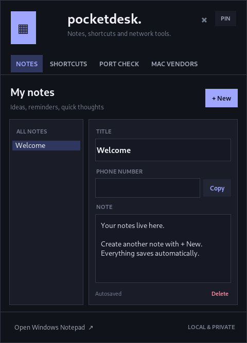
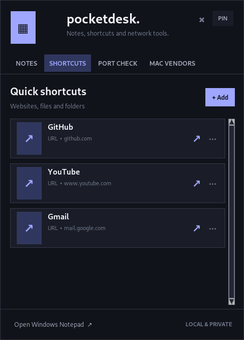
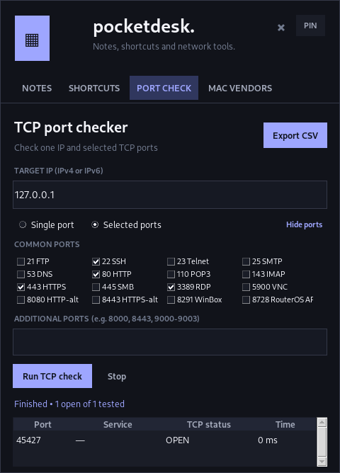
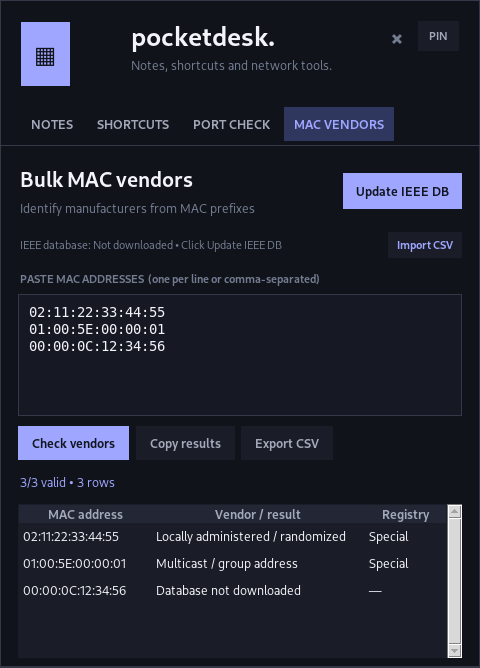

<div align="center">

# PocketDesk

**A compact Windows system-tray dashboard for notes, shortcuts, and everyday network checks.**

  

No account, server, or caller-lookup API required.

</div>

## Preview

| Notes | Shortcuts |
|:--:|:--:|
|  |  |

| TCP port checker | MAC vendor checker |
|:--:|:--:|
|  |  |

## Features

### 📝 Notes
- Create, edit, and delete multiple notes inside a small popup.
- Automatic local persistence between launches.
- Optional phone number on each note, with a **Copy** button that normalizes spaces and punctuation.
- **No reverse-phone lookup, Truecaller integration, or external contact service.**

### 🔗 Shortcuts
- Save quick links to **websites, local files, or folders**.
- Add/edit shortcuts with a local file/folder picker.
- Open each shortcut directly from the dashboard.

### 🔌 TCP Port Checker
- Check a TCP port on an IPv4 address, IPv6 address, or hostname.
- Select common ports or enter additional ports/ranges, up to **128** per run.
- See **OPEN, CLOSED, TIMEOUT,** or **ERROR**, and export results to CSV.
- Tests TCP connection reachability; this is not a full network vulnerability scanner or a UDP checker.

### 🏷️ Bulk MAC Vendor Checker
- Paste many MAC addresses in common formats (colon, hyphen, dotted, or compact).
- Download the public IEEE MA-L, MA-M, and MA-S assignment files or import the CSV files manually.
- Look up vendor assignments **offline** once the local database is populated.
- Export lookup results to CSV. Vendor prefix assignments do not prove a device's manufacturer or owner.

## Quick start — Windows

1. Install **Python 3.10 or later** from [python.org](https://www.python.org/downloads/windows/). Tkinter is normally bundled with the Windows installer.
2. Download or clone this repository:
   ```powershell
   git clone https://github.com/Dovshmi/Pocket.git
   cd Pocket
   ```
3. Double-click **`run.bat`** (or run `pyw -3 app.pyw`).
4. Click the PocketDesk icon in the notification area near the Windows clock. You might need to expand the `^` hidden icons menu.

> Source-mode operation uses Python's standard library. You do not need the build dependencies unless you're creating an EXE.

## Build a standalone EXE

On **Windows**, double-click **`build-exe.bat`**. The script installs the pinned-range PyInstaller dependency and generates:

```text
dist\PocketDesk.exe
```

You can distribute that EXE to a compatible Windows machine without installing Python. No compiled EXE is stored in the source repository. Builds and native tray behavior **have not been independently verified on Windows**; if a build fails, run the script in a terminal to inspect the error output.

## Data storage & privacy

User data is stored outside the repository under:

| Path | What it holds |
|---|---|
| `%APPDATA%\PocketDesk\data.json` | Notes, optional phone numbers, shortcuts, port-check settings |
| `%APPDATA%\PocketDesk\vendors.json` | Downloaded IEEE MAC vendor data |

Notes and phone numbers are stored locally; copying a phone number uses the clipboard and makes **no network request**. The app accesses the network only when you open a URL shortcut, check a network port, or download IEEE vendor data. Avoid committing or publicly sharing your local data files.

Upgrading from earlier PocketDesk versions keeps existing notes and shortcuts; older phone lookup configuration files, if present, are simply not used.

## Project layout

```text
Pocket/
├── app.pyw                  # System tray & four-tab Tkinter interface
├── shortcut_utils.py        # Phone formatting; URL/file/folder shortcuts
├── network_tools.py         # TCP checks and IEEE vendor lookup
├── assets/                  # Tray icon resources
├── screenshots/             # README illustrations
├── run.bat                  # Launch silently using pythonw
├── build-exe.bat            # Windows PyInstaller build
├── requirements-build.txt   # Build-only dependency
├── test_*.py                # Unit tests
└── smoke_*.py               # Optional GUI smoke tests
```

## Testing

Run the unit tests from the repository root:

```powershell
py -3 -m unittest discover -v
```

**17 unit tests passed** in the supplied development environment, including local TCP test connections, phone number normalization, data migration, and file/folder shortcut validation. Desktop UI checks have been performed on Linux/Xvfb. Native Windows EXE and system-tray behavior still need to be verified on a real Windows system.

## Troubleshooting

- **No tray icon:** Look under the `^` hidden notification icons near the clock; confirm Python was installed with Tkinter.
- **Nothing happens when launching:** Run `py -3 app.pyw` from PowerShell to see startup errors.
- **Port shows CLOSED/TIMEOUT:** Check routing, host firewalls, service availability, and the selected TCP port; a timeout does not necessarily mean the service is down.
- **MAC vendor missing:** First use **Update IEEE DB** or import the IEEE CSV registry files. Locally administered/randomized MACs may not resolve to a vendor.
- **Old notes missing:** Check the existing `%APPDATA%\PocketDesk\data.json` under the Windows account running the app.

## Security & responsible use

Only run port checks against systems you own or are explicitly authorized to test. The app's local file/folder shortcuts launch paths you select; review shortcuts before opening files from untrusted sources.

## Version history

**v1.6 (current):** Removed all caller-lookup services and browser integrations. Notes retain an optional phone number and **Copy** button. Keeps Notes, Shortcuts, Port Checker, and MAC Vendor Checker.

Earlier iterations experimented with phone lookup, but those components are **not part of this release**.
