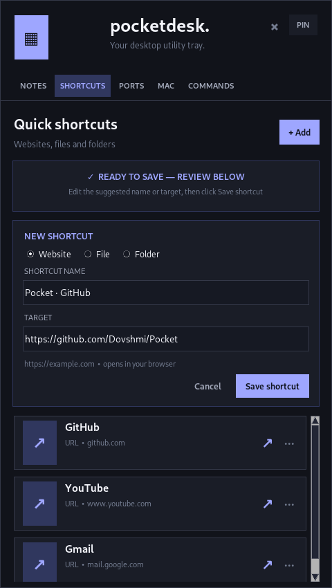

# PocketDesk

**A compact, movable Windows system-tray toolbox.** Keep notes, open shortcuts, check TCP ports, identify MAC vendors, search network CLI commands, and calculate IPv4 subnets from a single lightweight popup.


> **Version 1.18** · Windows 10/11 · Python 3.10+ · Local-first · No account required
>
> This public repository contains **generic example CLI commands only**. Private operational command libraries and user data are not included.

## What it can do

| Tab | What you get |
| --- | --- |
| **Notes** | Autosaved text notes with titles, phone numbers, creation timestamps, pinned notes, duplicate/delete actions, a full-width editor, and right-click actions. |
| **Shortcuts** | Quick-launch websites, folders and files; drag a URL or Explorer item to prefill a new shortcut and review before saving. |
| **Ports** | Test one TCP port or a selection/range against an IPv4 or IPv6 target; copy/export the results. |
| **MAC** | Bulk IEEE OUI vendor lookups; download or import registries and export CSV results. |
| **Commands** | Search CLI reference text and its description by machine; temporarily edit before copying; create your own saved commands and favorites. |
| **Subnet** | Calculate IPv4 CIDR/netmask, network/broadcast, wildcard, usable range and subnet splits; copy details or individual networks. |

### New in v1.18: move the window and remember its position

PocketDesk still starts as a notification-area popup, but **you can drag the header** (logo/title area) to move it like a normal window. Its position saves automatically on mouse release and is restored when you reopen the app, switch tabs, or use the keyboard toggle.

**Right-click the header → Reset window position** to return to its original location near the tray. Window coordinates are stored locally in `%APPDATA%\PocketDesk\data.json`. If display/monitor dimensions change, PocketDesk attempts to keep the window visible rather than restore it off-screen.

### New since v1.16

**v1.17 — Subnet & note management:** A dedicated IPv4 subnet tab with subnet splits and clipboard actions. Right-click an item in **All Notes** to **Pin/Unpin**, **Duplicate**, or **Delete**. Pinned notes appear first, and duplicates get a new ID and creation timestamp. Notes are flushed before switching or duplicating so the most recent edit is retained.

**v1.18 — Movable window:** Drag the header, reopen at the saved position, and reset from the header context menu. The PIN button and global shortcut continue to work.


## Install and run on Windows

1. Download the repository ZIP using **Code → Download ZIP**, or clone it:
   ```powershell
   git clone https://github.com/Dovshmi/Pocket.git
   cd Pocket
   ```
2. Install [Python 3.10 or newer](https://www.python.org/downloads/windows/) with Tkinter (part of the usual Windows installer).
3. Double-click **`run.bat`**. The script installs Python dependencies when needed.
4. Find the PocketDesk icon beside the Windows clock; it may be under the **`^`** hidden-icons menu. Click to show/hide PocketDesk.

For manual installation, run `install.bat` before launching `app.pyw`. Native drag-and-drop uses `tkinterdnd2`; the app can run without it, but native file/folder drops may be unavailable. The global shortcut and tray behavior require Windows.

### Global keyboard shortcut

Press **`Ctrl + Shift + *`** to toggle the popup while PocketDesk is running. The standard `*` above **8** (`Ctrl+Shift+8`) and **numpad multiply** are supported where Windows can register them. If another app holds the hotkey, use the tray icon.

**PIN** keeps the popup visible when another app gains focus, which helps when dragging from File Explorer or a browser. **X** hides the popup to the tray; it does not delete notes.

## Using the tabs

### Notes

The **title and compact phone field** sit in the top-left block; **All Notes** is top-right; the editable note text fills the lower portion. New notes receive a creation timestamp. Older imported notes without a stored creation time display *unknown* rather than a guessed date.

Right-click **a note in All Notes** to pin it to the top, duplicate it, or delete it with confirmation. Right-click **inside the text editor** for Undo/Redo/Cut/Copy/Paste/Select All, Copy Entire Note, Insert Date & Time, or Open in Notepad. Highlight an IP address for **Check selected IP** (fills the Ports target without starting a scan), or select CLI text for **Find in Commands**.

**Open in Notepad** creates a new `.txt` snapshot of the selected note in `%APPDATA%\PocketDesk\notepad_exports\`. Edits made in Windows Notepad are **not** synchronized back to PocketDesk.

### Shortcuts

Add a Website, File, or Folder manually, or click **PIN** and drag one item onto the Shortcuts drop zone. PocketDesk proposes a type, name and target; nothing is saved until you click **Save shortcut**. You can edit or cancel the draft. Saving or canceling closes the form completely, leaving no extra gap above the shortcut cards.




### TCP Ports

Enter a target, choose a single port, preset group or custom port list/range, then run a **TCP connection test**. Results may say OPEN, CLOSED, TIMEOUT or ERROR. A timeout does not prove a port is closed; filtering and network conditions can affect results. **Only test hosts you own or have authorization to check.**

### MAC Vendors

Paste MAC addresses in common formats, optionally download/import public IEEE assignment CSV files, then view and export vendor matches. The IEEE vendor label identifies a registered address block; it is **not proof of the individual device owner**. Lookup works offline after the prefix database is populated.

### Commands

Choose a machine or **All machines**, search by CLI syntax or description (including Hebrew), select a result, and adjust the editable command box before clicking **Copy edited**. This only puts text on the clipboard; it **never runs commands**.

Use **+ New** to create your own commands, machines, categories and descriptions. Custom commands, favorites and recently copied items remain on your computer. The public package ships with a small demonstration library for Cisco/FortiGate/Juniper/Nokia, **not** workplace-specific operational information.

To use a private command library, keep `commands/commands.json` in your *local* installation only. PocketDesk prefers that file when present and falls back to `commands/sample_commands.json` otherwise. **Do not commit private command packs.** The `.gitignore` excludes `commands/commands.json`.

### Subnet

Enter an IPv4 address and `/prefix` or dotted-decimal netmask, then calculate network, broadcast, first/last usable address, wildcard and address counts. Use the split controls for smaller CIDR blocks. `/31` and `/32` have special handling. All calculations are local; the calculator does not connect to target hosts.

## Build a standalone `.exe`

Double-click **`build-exe.bat`** on Windows. It uses PyInstaller and bundles the icon, TkDnD files, and the available command library. The output is `dist\PocketDesk.exe`.

**Important:** If you build on a PC containing `commands/commands.json`, the generated EXE can contain that **private** library. Build public releases from a clean checkout without the private file. The public GitHub checkout bundles the example library only.

The executable is not prebuilt in this repository; native Windows packaging and multi-monitor behavior still need independent verification on Windows.

## Data and privacy

PocketDesk stores data in `%APPDATA%\PocketDesk\`:

| Path | Purpose |
| --- | --- |
| `data.json` | Notes, phones, shortcuts, favorite/custom CLI commands, tab preferences and saved window coordinates. |
| `vendors.json` | Downloaded/imported IEEE MAC vendor registry cache. |
| `notepad_exports\` | Snapshots of notes opened in Windows Notepad. |

- Notes, phone numbers, and user-created commands are stored locally in **plain text**, not encrypted. Do not store passwords or secrets unless you secure your Windows account and files accordingly.
- Copy actions use the clipboard. PocketDesk does not send note text or copied CLI commands to a caller-lookup API.
- MAC registry updates and network port checks do use the network when you request them.
- User data files, private command files, virtual environments and build products are excluded by `.gitignore`.

## Development and tests

```powershell
py -3 -m unittest discover -v
```

Tests cover storage, subnet arithmetic, note pin/duplicate/delete, window-position normalization/persistence/clamping, keyboard hotkey logic, command reference, URLs and TCP/MAC tools. GUI smoke scripts require a working desktop/display and are **not** the same as verifying real Win32 tray interaction on Windows.

### Troubleshooting

- **No tray icon:** Check the notification-area `^` menu, then verify that PocketDesk is still running.
- **Drag and drop fails:** Run `install.bat`, relaunch, click PIN, and drag one item at a time. Some browser drag types are unsupported; paste the URL manually instead.
- **Shortcut hotkey does nothing:** Another app may own that hotkey, or PocketDesk may not be running. Click the tray icon.
- **Popup is off-screen:** Right-click the header and choose **Reset window position**; it also attempts to constrain saved positions when monitor layouts change.
- **No CLI reference results:** Make sure `commands/sample_commands.json` exists, select **All machines**, and clear the search/category filters.
- **Cannot build EXE:** Verify Python and Windows PyInstaller dependencies, then run `build-exe.bat` in a terminal to see the error.

## License

See the existing [LICENSE](LICENSE) file for licensing terms.
