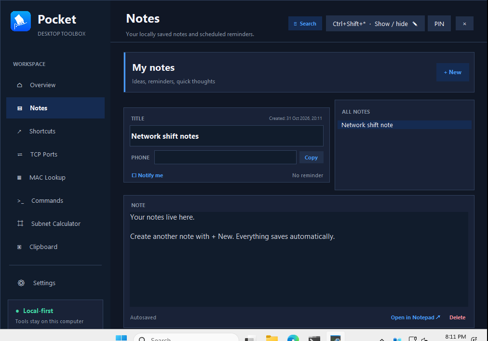
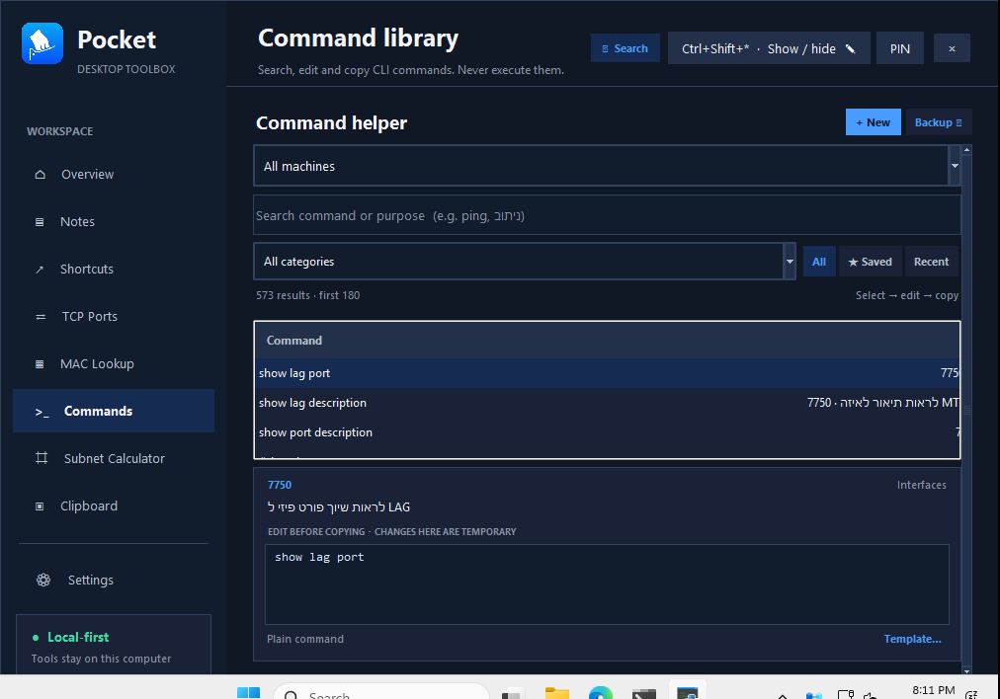
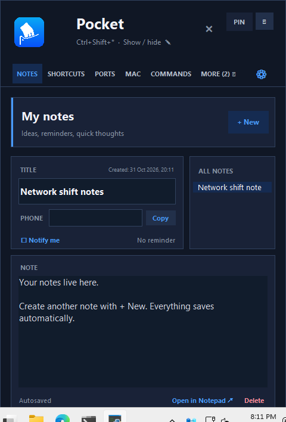
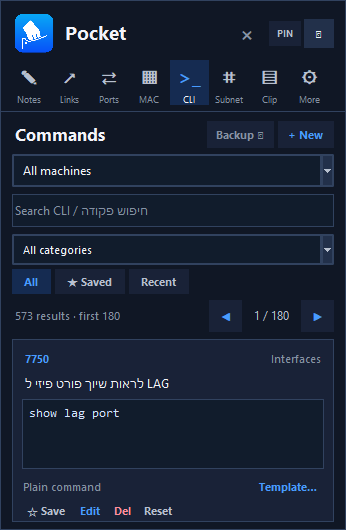

<div align="center">


# Pocket

**Your everyday Windows toolbox. One shortcut away.**

A lightweight, local-first toolkit for NOC/SOC work, network troubleshooting, notes, and everyday productivity.

[](https://github.com/Dovshmi/Pocket/tree/main)
[](https://github.com/Dovshmi/Pocket/releases/tag/v1.38.0)


[](LICENSE)

**Latest published release:** [Portable ZIP v1.38.0](https://github.com/Dovshmi/Pocket/releases/download/v1.38.0/Pocket-Portable-v1.38.0.zip) ·
[Standalone EXE v1.38.0](https://github.com/Dovshmi/Pocket/releases/download/v1.38.0/Pocket-v1.38.0.exe) ·
[All Releases](https://github.com/Dovshmi/Pocket/releases)

</div>

---

Pocket runs from the Windows system tray and opens on demand. It brings seven practical tools together in **Normal, Mini, Dashboard, and Extra Mini** layouts, with six color themes and customizable visible menus. Notes, CLI references, subnets, and clipboard history work without an internet connection; network access is initiated only when you request it.

> [!IMPORTANT]
> **Version clarification:** The `main` branch contains **Pocket v1.39.0**, including the latest backup/restore and keyboard updates. The most recent **published release with downloadable EXE/ZIP assets is v1.38.0**. To run the latest `main` source, build it locally or use a verified GitHub Actions preview artifact. Release download buttons above still point to v1.38.0; no v1.39.0 release asset is claimed.

> [!NOTE]
> **Offline-first:** Notes, CLI, subnet calculations, clipboard and backup/restore work locally. Network access is initiated only by explicitly requested checks or opened web links. See [release notes](RELEASE_NOTES.md) and [clipboard storage details](docs/CLIPBOARD_DATABASE.md).

## What's new in `main` — v1.39.0

Pocket v1.39 adds portable profile transfers, direct numbered clipboard slots, live keyboard-shortcut recording and safer settings management. These changes are **merged into `main`**, not yet part of the published v1.38.0 downloads.

### Selective Backup & Restore

Under **Settings → Backup & Restore**, create a single local ZIP containing only the information you choose:

| Backup category | Included |
| :--- | :--- |
| **Notes & reminders** | Titles, text, phone fields, timestamps, pins and reminder data |
| **Links & folders** | Websites, application/file/folder shortcuts and folder arrangement |
| **CLI Commands** | Writable command library, Smart Templates, custom commands and saved selections |
| **Settings** | Theme, layouts, visible menus, keyboard preferences and network settings |
| **Clipboard DATABASE text** | Stored text history, if available |
| **Clipboard DATABASE screenshots** | Stored PNG screenshots, if available |
| **Quick Slots** | **Excluded entirely**, including slot content and their shortcut preferences |

- **Smart selection:** Available categories are checked automatically; absent or empty categories appear disabled. Deselect any available category to create a partial backup.
- **Restore on another PC:** Open the ZIP, preview the included categories, and choose **Merge** (add missing entries while keeping conflicting local items) or **Replace** (replace selected categories only). The restore preview scrolls by mouse wheel with no visible scrollbar.
- **Safety:** Pocket verifies the backup ZIP before importing and saves a local pre-restore recovery ZIP. A completed restore closes Pocket so settings can reload after reopening.
- **Local by design:** No cloud synchronization or automatic backup on edits. Backup ZIPs are **not encrypted**; review Notes, CLI data and Clipboard history for sensitive information before sharing. Machine-specific local file targets may need correction after transfer.

[Backup and restore guide](docs/BACKUP_RESTORE.md)

### Quick Slots — direct Numpad copy and paste

With **Num Lock ON**, use the two separate global shortcuts:

| Action | Default shortcut |
| :--- | :--- |
| Save selected text (or current clipboard text) to slot 1–9 | `Ctrl+Win+Numpad1–9` |
| Paste saved slot 1–9 into the focused application | `Ctrl+Alt+Numpad1–9` |

Saving highlighted text behaves like Windows **Ctrl+C** and also updates the regular clipboard. The paste operation preserves the existing clipboard. Both modifier prefixes can be changed independently in Settings; **Numpad1–9 cannot be reassigned**. An existing slot asks for confirmation before overwrite. All slot data stays on the local computer and is **not included in Backup & Restore**.

[Quick Slots usage and privacy](docs/QUICK_SLOTS.md)

### Record shortcuts & reset defaults

- **Record Shortcut:** Capture a popup or Translate shortcut by pressing the desired keys in the Settings recorder, with the manual picker retained. Quick Slot recording changes modifiers only, never the numbered Numpad key. A conflicting shortcut keeps the previous configuration.
- **Default Settings:** Reset selected groups (appearance, menus, keyboard, clipboard preferences, network) without deleting personal Notes, Links, CLI, Clipboard DATABASE files or saved Quick Slot text.
- **Updated Settings:** The footer reports **v1.39.0**, with the backup/restore controls available in the regular Settings UI.

### Version highlights

| Version | Main changes |
| :--- | :--- |
| **v1.39.0 — current `main`** | Selective portable ZIP backups, restore preview and merge/replace, Quick Slots, live shortcut recording, default-settings reset and UI refinements |
| **v1.38.0 — latest published release** | Clipboard selection count, RAM screenshot choices, database display limits, persistent Clipboard history, Notes/Notepad sync and proxy support |
| **v1.37 — incorporated into v1.38.0** | Optional local Clipboard DATABASE, EN/HE keyboard layout repair and Windows proxy selection |
| **v1.36.0** | Native Windows text-input improvements, ordered port-check results, Mini Commands improvements |
| **v1.35.1 / v1.35.0** | Clipboard alignment, Dashboard layout fixes, redesigned Settings and compact launcher |

Older version: [Portable v1.36.0](https://github.com/Dovshmi/Pocket/releases/download/v1.36.0/Pocket-Portable-v1.36.0.zip) · [EXE v1.36.0](https://github.com/Dovshmi/Pocket/releases/download/v1.36.0/Pocket-v1.36.0.exe). Full details are in [release notes](RELEASE_NOTES.md) and [GitHub Releases](https://github.com/Dovshmi/Pocket/releases).

## New in v1.38.0

- **Clipboard Text status:** The grey status line shows the selected item position and the number of displayed entries without adding or moving controls.
- **RAM screenshots:** Choose **10 / 15 / 20 / 25 / 30**, default **20**.
- **DATABASE display:** Choose **100 / 300 / 500 / 800 / 1000 / 1200 / 1500** text entries (default **100**); screenshot display remains independently configurable from 10 to 100.
- **Opt-in local clipboard history:** Daily append-only TXT journal, flat date-stamped PNG folder, date browsing, scrolling to older entries and optional 7–30-day retention cleanup (OFF by default).
- **Notes + Notepad:** New notes append to the picker; renaming the note also safely renames its TXT file, with numbered names for duplicates.
- **Windows Proxy and IEEE MAC vendor updates:** A saved **Use Windows Proxy** toggle supports Windows PAC or explicit direct HTTPS, while keeping Windows certificate validation enabled.
- **Offline EN/HE keyboard repair:** Configurable `Ctrl+Alt+V` shortcut and **Mark / Clipboard** modes. Mark replaces selected text in compatible Windows applications; clipboard mode keeps the earlier copy-and-convert workflow.

All features retain Pocket's local-first design. Internet access is initiated only by an explicit network action. **Note:** Optional DATABASE history stores text and screenshots as local plaintext; enable it on managed computers only where policy permits. Test corporate PAC routes and third-party text replacement on the target PC.

## Screenshots

These are **real Pocket screenshots from Windows GUI tests** (not mockups). The images were captured in **v1.30.0**; later releases refined some layouts. See the [latest UI-test artifacts](https://github.com/Dovshmi/Pocket/actions/workflows/mini-checks.yml) for additional captures.

<div align="center">


**Dashboard**

<table>
<tr>
<td align="center"><br /><strong>Notes</strong></td>
<td align="center"><br /><strong>Commands</strong></td>
</tr>
<tr>
<td align="center"><br /><strong>TCP Port Checker</strong></td>
<td align="center"><br /><strong>Extra Mini</strong></td>
</tr>
</table>
</div>

<details>
<summary><strong>View more real app screenshots</strong></summary>

| Normal Notes | MAC Vendor Lookup | Mini Commands |
|:---:|:---:|:---:|
|  |  |  |

| Subnet Calculator | Clipboard | Dashboard Settings |
|:---:|:---:|:---:|
|  |  |  |

</details>

## Tools at a glance

| Tool | What it does | Connectivity |
| :--- | :--- | :--- |
| **Notes & reminders** | Titled notes with phone numbers, creation times, RTL/LTR editing, pin/duplicate, Notepad integration, and native Windows reminders | Offline |
| **Commands Helper** | Searchable CLI references by device/topic; edit, favorite, fill validated Smart Templates such as `{{IP}}`, then copy | Offline |
| **Quick Shortcuts** | Open websites, files, and Windows folders; group in collapsible Pocket folders, drag to reorder, or drop directly into a folder | Online only when you open a web link |
| **TCP Port Check** | Check up to **16 TCP ports** per run, with favorites, last-check suggestions, status sorting, and CSV export | Local or optional DashDash |
| **MAC Vendor Lookup** | Search cached IEEE registrations (MA-L, MA-M, MA-S, IAB), import CSV, or query DashDash | Local or optional DashDash |
| **Subnet Calculator** | IPv4 CIDR, masks, wildcard, network/broadcast, usable hosts, and subnet splitting | Offline |
| **Clipboard Manager** | Text/Images pages, optional persistent daily history, pin/search, screenshots, database retention and 9 direct Quick Slots for copy/paste | Offline |

**Commands are references, not scripts:** Pocket never executes a saved CLI command. Smart Templates fill placeholders before copying. The **Commands-only Backup** remains a separate manual action; the new **Settings → Backup & Restore** creates a portable ZIP only on request.

**Reminders** use Windows tray notifications while Pocket is running or minimized to the tray, with overdue unsent reminders checked at the next launch. Hiding the Clipboard menu stops clipboard monitoring. **Clipboard RAM mode never writes history to disk**; optional DATABASE mode writes plaintext text and screenshots locally under `ClipboardDatabase/` in Pocket's user data directory. Sensitive-text filtering is heuristic, and database mode should only be enabled where permitted. [Clipboard database and retention details](docs/CLIPBOARD_DATABASE.md).

## Earlier improvements

Pocket retains the features introduced in previous versions: reliable native Windows text editing; right-click input actions; MAC/CLI long-text support; TCP port results sorted with reachable ports first; Mini Commands machine/category controls; automatic ordering of pinned Clipboard entries; and six theme palettes.

Notes support title-synchronized Notepad files, reminders and pin/duplicate actions. Clipboard supports separate **Text** and **Images** views, daily DATABASE history (opt in), and RAM-only operation by default. Settings offer adjustable modes, visible menus, Quick Search, keyboard layout repair, privacy controls and configurable shortcut recording.

See the [release history](https://github.com/Dovshmi/Pocket/releases) for version-specific details.

## Local vs. DashDash network checks

| Mode | Where the network check runs | Supported targets |
| :--- | :--- | :--- |
| **Local (default)** | On your Windows computer | TCP checks to reachable IPv4/IPv6, including private networks; MAC lookup from your local IEEE cache |
| **DashDash (opt-in)** | Pocket sends an HTTPS request to the DashDash API; the remote TCP test runs on Vercel | **Public IPv4 only** for TCP checks, up to 16 ports; remote MAC lookup up to 100 addresses |

- **Windows corporate networks:** for explicitly requested DashDash checks, Pocket uses the signed-in user's approved Windows proxy configuration, resolves PAC/WPAD for the destination, and sends HTTPS through the native Windows stack. There are no hard-coded workplace proxy settings, and certificate validation is not disabled.
- **No background scans:** switching modes does not run a check. Remote requests occur only after clicking **Run TCP check** or **Check vendors**. Offline tools do not depend on DashDash.
- **Know the source:** a DashDash TCP result measures reachability **from Vercel**, not from your work PC; use Local mode for internal networks. The DashDash API is public and has no Pocket account-level authentication. Only check targets you are authorized to test, and do not submit confidential customer or infrastructure data.

[How Windows Proxy/PAC works](docs/WINDOWS_PROXY.md)

## Window layouts and everyday controls

| Layout | Designed for |
| :--- | :--- |
| **Normal** | Everyday menu-based work |
| **Mini** | Compact workspace alongside other applications |
| **Dashboard** | Wider side-by-side tools and editing |
| **Extra Mini** | Optional quick-action launcher with customizable tiles and pages |

Pocket remembers window placement, last active tool and supports **Blue, Dark Blue, Black, Red, Green, and Purple** themes. Pin the popup to keep it open, or close it to hide it in the tray.

| Action | Shortcut / control |
| :--- | :--- |
| Show or hide Pocket | Tray icon or configurable global hotkey |
| Quick Search across enabled tools | `Ctrl+K` |
| Find commands while in Commands | `Ctrl+F` |
| New note | `Ctrl+N` |
| Save | `Ctrl+S` |
| Save selected text to Quick Slot N | `Ctrl+Win+Numpad1–9` (Num Lock ON) |
| Paste Quick Slot N | `Ctrl+Alt+Numpad1–9` (Num Lock ON) |
| Fully quit | Tray icon → **Exit** |

## Download and use

### Portable ZIP — recommended for a work PC

1. Download the latest published **[Pocket-Portable-v1.38.0.zip](https://github.com/Dovshmi/Pocket/releases/download/v1.38.0/Pocket-Portable-v1.38.0.zip)**.
2. **Extract the whole archive** into a writable local folder. Do not run the EXE inside the ZIP.
3. Launch `Pocket-Portable/PocketDesk.exe` and leave the `_internal/` folder beside it.
4. Choose a window layout and theme in Settings.

No Python installation is required. The portable version stores personal data under `Pocket-Portable/data/` beside the EXE. For upgrades, fully exit Pocket, back up `data/`, extract the new release into a **different** folder, and copy your personal `data/` folder over. Never mix old and new `_internal/` runtime files. To use the newest `main` features before an official release, build from source or use a tested development artifact; do not expect them in the v1.38.0 downloads.

### Standalone EXE

Download the latest published **[Pocket-v1.38.0.exe](https://github.com/Dovshmi/Pocket/releases/download/v1.38.0/Pocket-v1.38.0.exe)** and run it directly. It stores its user data in `%APPDATA%\\PocketDesk\\` rather than beside the EXE.

> [!IMPORTANT]
> Releases are **unsigned**. Corporate application-control, antivirus, or proxy policies may block the program. Use Pocket only where authorized; do not disable workplace security controls. [Portable workplace troubleshooting](docs/WORKPLACE_PORTABLE.md).

## Privacy and data

Pocket has **no mandatory account, cloud sync, or continuous internet requirement**.

| Data | Storage |
| :--- | :--- |
| Notes, settings, reminders, shortcuts, launcher setup | Local `data.json` |
| Personal CLI commands and Smart Template metadata | Local `commands.json` |
| IEEE vendor cache | Local `vendors.json` |
| Clipboard history | **RAM by default**; optional daily TXT/PNG database, text batches up to 1,500 and screenshot batches up to 100, OFF / 7–30-day cleanup |
| Recoverable settings snapshot | Local `data-recovery.json` |
| Portable selective backups | Explicit user-created ZIP; validated before restore, with a pre-restore safety ZIP under `backups/` |
| Quick Slots | Local saved clipboard slots in `data.json`; deliberately **not included** in portable backups |

Public Windows releases contain the **sanitized example command library only**—not private commands, notes, passwords, customer information, or backups. Pocket files and exported backup ZIPs are **not encrypted**, so protect both your data folder and any backups. By default, neither RAM clipboard history nor Quick Slots are exported. Remote DashDash mode sends only targets you explicitly submit; local lookups and backups never upload them.

## Develop and contribute

**Stack:** Python 3.10+, Tkinter/ttk, native Windows APIs, Pillow, tkinterdnd2, and PyInstaller.

```powershell
git clone https://github.com/Dovshmi/Pocket.git
cd Pocket
py -3 -m pip install -r requirements.txt
py -3 app.pyw
```

**Tests and Windows packaging:**

```powershell
py -3 -m unittest discover -s tests -p "test_*.py" -v
.\build-portable.bat
.\build-exe.bat
```

GitHub Actions runs Windows/Linux regression checks, GUI smoke tests, and packaged Windows startup/integrity checks for releases. The portable build bundles its own Python runtime and only public example commands.

**Useful links:** [Release history](https://github.com/Dovshmi/Pocket/releases) · [Project layout](docs/REPOSITORY_LAYOUT.md) · [Report an issue](https://github.com/Dovshmi/Pocket/issues)

---

<div align="center">

**Pocket — small tools, one workspace.**

GPL-3.0 · Windows 10/11

</div>
