<div align="center">


# Pocket

### Your everyday Windows toolbox. One shortcut away.

**Notes · CLI commands · TCP checks · MAC lookup · Subnets · Shortcuts · Clipboard**

A customizable, **local-first Windows tray application** for the small tools you reach for every day. No browser, account, cloud sync, or permanent internet connection required.

[](https://github.com/Dovshmi/Pocket/releases/tag/v1.32.1)


[](LICENSE)

**[Download portable ZIP](https://github.com/Dovshmi/Pocket/releases/download/v1.32.1/Pocket-Portable-v1.32.1.zip)** · **[Download standalone EXE](https://github.com/Dovshmi/Pocket/releases/download/v1.32.1/Pocket-v1.32.1.exe)** · **[Releases](https://github.com/Dovshmi/Pocket/releases)** · **[Issues](https://github.com/Dovshmi/Pocket/issues)**

</div>

---

> [!NOTE]
> **Current stable: v1.32.1.** This maintenance release repairs Pillow binary packaging for Windows and adds tests of freshly extracted downloads. The Dashboard improvements and local-data safeguards from v1.32.0 are unchanged.

## Why Pocket?

Pocket lives in the **Windows notification area** until you need it. Open it via a configurable global shortcut or its tray icon, use a tool, then hide it again. It is especially useful when switching between network troubleshooting, CLI reference material and everyday notes.

- **Seven tools**, accessible from one application.
- **Four ways to work:** Normal, Mini, Dashboard, and an optional Extra Mini launcher.
- **Works offline** for notes, commands, search, subnets and clipboard history.
- **User-controlled network access:** TCP tests and IEEE registry downloads start only when requested.
- **Copy, never execute:** saved CLI commands and generated templates remain references, not a remote shell.
- **Personalizable:** six color themes, movable windows, configurable menus, and saved launcher actions.

## Screenshots

These are **genuine Pocket screenshots captured during Windows GUI tests**, not generated mockups. The checked-in images are from **v1.30.0**. Dashboard layouts were refined in v1.32.1, so these show real features but not necessarily the exact current pixel arrangement. See [the latest GUI-test artifacts](https://github.com/Dovshmi/Pocket/actions/workflows/mini-checks.yml) for newer test captures.

<div align="center">
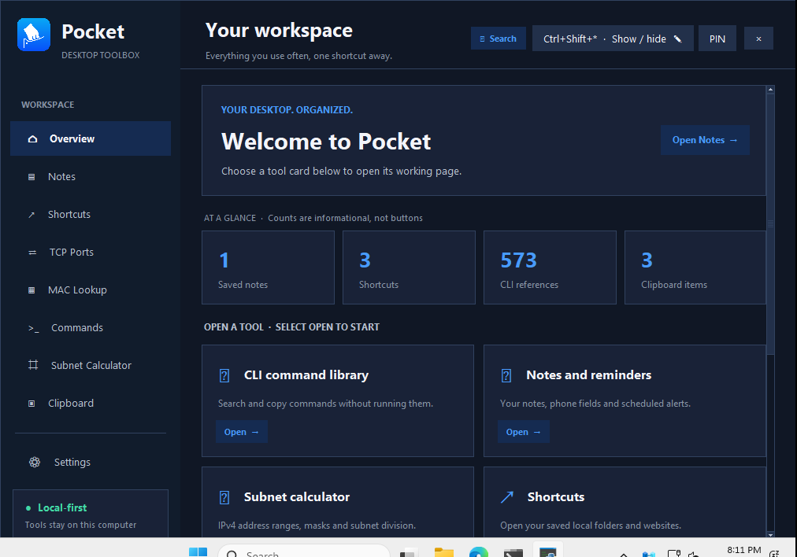

**Dashboard**

<table>
<tr>
<td align="center">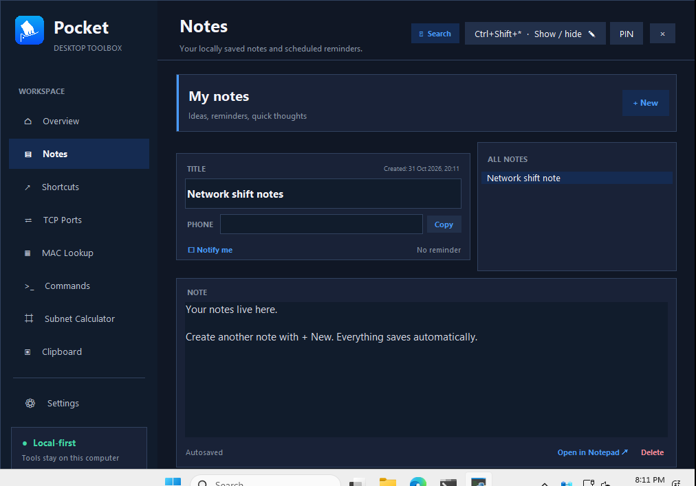<br /><strong>Notes</strong></td>
<td align="center">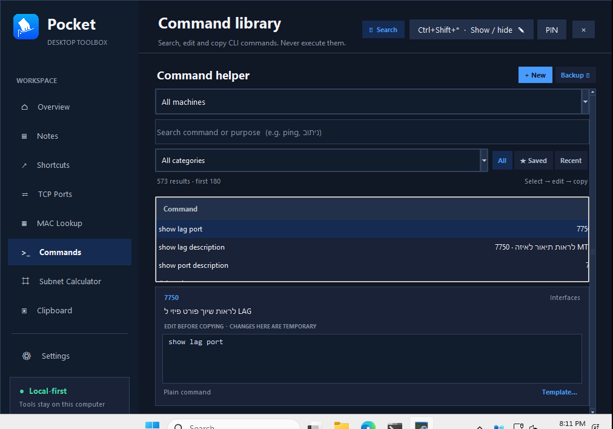<br /><strong>Commands</strong></td>
</tr>
<tr>
<td align="center">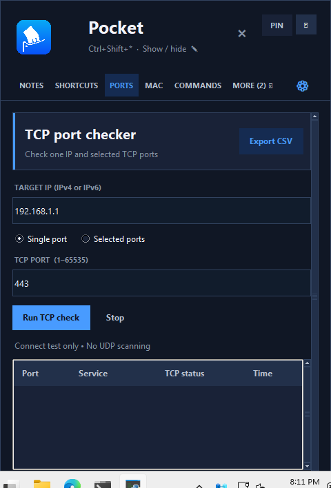<br /><strong>TCP Port Checker</strong></td>
<td align="center">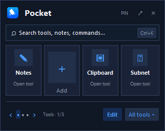<br /><strong>Extra Mini</strong></td>
</tr>
</table>
</div>

<details>
<summary><strong>View more real app screenshots</strong></summary>

| Normal Notes | MAC Vendor Lookup | Mini Commands |
|:---:|:---:|:---:|
| 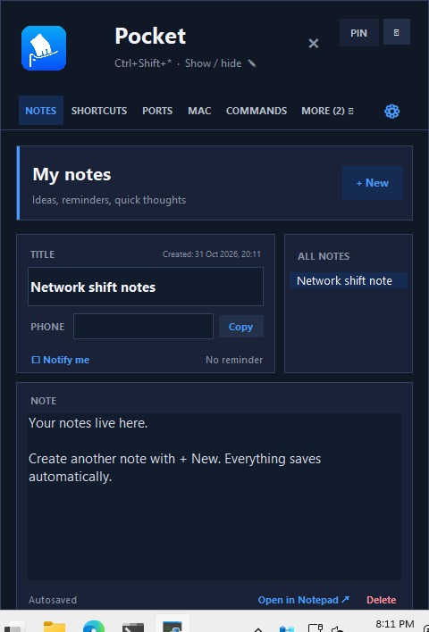 | 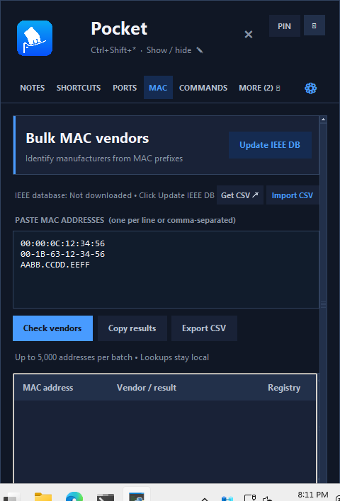 | 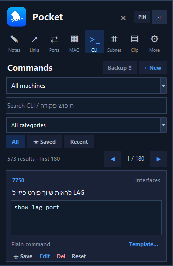 |

| Subnet Calculator | Clipboard | Dashboard Settings |
|:---:|:---:|:---:|
| 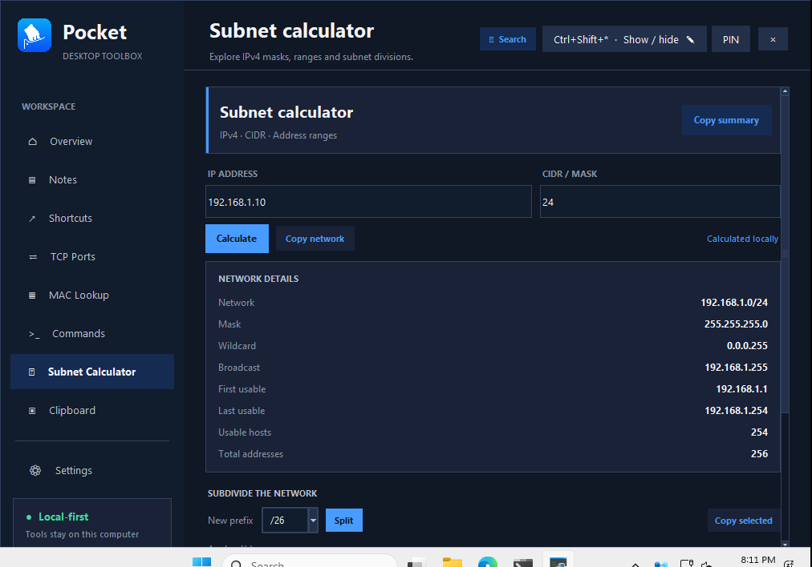 | 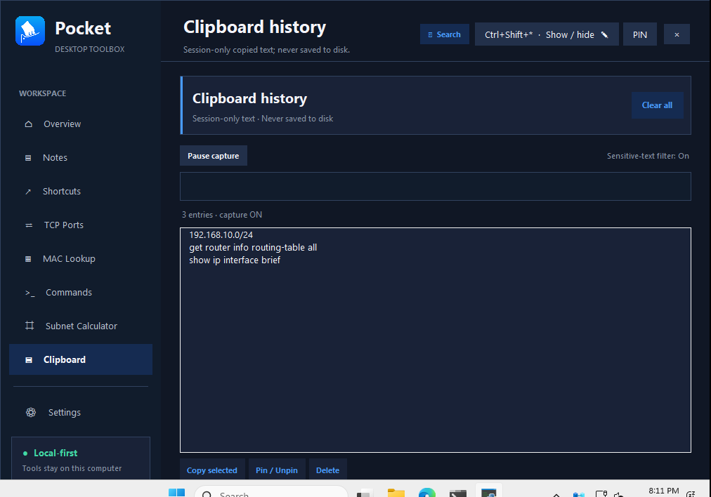 | 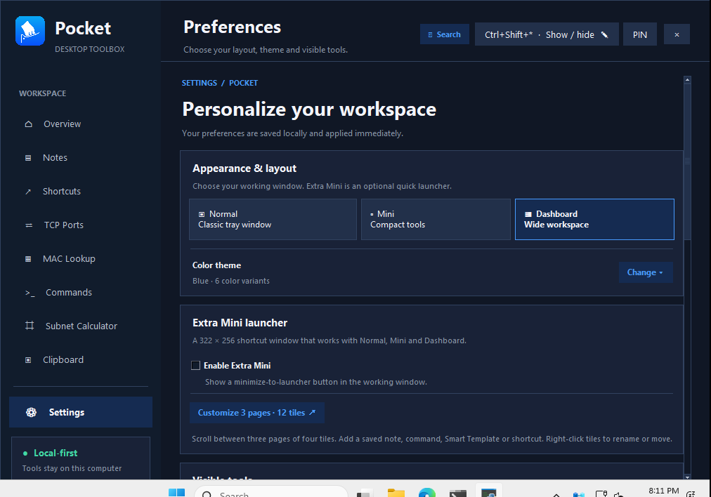 |

</details>

## Features at a glance

| Menu | Capabilities | Connectivity |
|:---|:---|:---|
| **Notes** | Notes with titles, phone numbers, timestamps, pinning, duplication, Notepad editing, Hebrew/English direction and reminders | Offline |
| **Commands** | Local CLI search, categories, machines, favorites, editing, Smart Templates and manual library backup | Offline |
| **Shortcuts** | Save, find and open URLs, files and directories | Online only when opening a web link |
| **TCP Ports** | Scan chosen TCP ports and ranges on a specified IPv4/IPv6 address, with export | User-initiated network test |
| **MAC Lookup** | IEEE vendor-prefix lookup, offline cache, batch lookup, manual registry update/import | Offline with cache; internet for update |
| **Subnet Calculator** | IPv4 CIDR, network/broadcast, masks, wildcard, hosts, and network splitting | Offline |
| **Clipboard** | Session-only text history, search, pin, copy, delete, pause and privacy filter | Offline |

### Notes & reminders

- Create notes with a **title, optional phone number, creation date/time and full text body**.
- **Pin, duplicate or delete** notes; use the context menu for common editing actions.
- Set **RTL or LTR** text direction; the Windows editor supports mixed Hebrew and English.
- Open the selected note in **Windows Notepad**. Saved Notepad edits can synchronize back to Pocket; simultaneous changes are handled as conflicts rather than silently overwritten.
- Add an **optional one-time reminder**. Pocket checks for reminders while open or hidden in the tray and checks overdue unsent reminders on the next launch. Alerts use native Windows tray notifications, subject to Windows notification settings.

### CLI command library & Smart Templates

The Commands screen is a **searchable reference and copy workspace**, not a terminal. Search by device, category, description, or command text (including Hebrew). Edit or add entries, favorite useful references, review recent commands, and copy them to the clipboard.

With **Smart Templates**, an existing command can include fields such as `{{IP}}`, `{{INTERFACE}}` or `{{VLAN}}`:

1. Select a command, then choose **Template…**.
2. Review suggested placeholders or define your own; optional field validation includes IP, CIDR, VLAN, port, interface, VRF, MAC, integer and choice values.
3. Save the approved template, use **Fill & copy**, and review the generated output before copying.
4. If the original command changes, the template requires approval again before it can generate output.

**No command is ever executed.** Filled template values are not saved. Templates work entirely offline, and ordinary commands remain usable without them.

**Backups are manual by design:** choose **Commands → Backup → Create new backup** when you want one, or **Use existing backup** to restore. Normal edits never generate a command backup automatically. Your private command library is separate from the public examples shipped with the app.

### Network utilities

**TCP Port Checker** — one shared **TCP Ports** field accepts one or more comma-separated numbers (for example, `22,80,443,3389`), up to **16 unique ports** per check in **both** modes. The `0/16` counter flags too many or invalid entries. Use **Quick Port Selection** to expand the preset panel only when needed. Each click **adds a port to the existing field without replacing manually entered numbers**; clicking an already-selected preset removes only that port. **Clear** empties the field. More than 30 TCP presets are available, including HTTPS, SSH, RDP, WinBox, IMAPS, LDAP, SQL databases, Redis, MongoDB, MQTT and Kubernetes API. Both the field and presets stay usable in Normal, Mini and Dashboard.

- **Local (this PC)** is the default. Enter a literal IPv4 or IPv6 address. Connections originate from your Windows PC, including reachable private LAN addresses; no DashDash request is sent.
- **DashDash (remote)** sends one explicit HTTPS request to `https://dashdash-tau.vercel.app/api/port-check`. The DashDash/Vercel server checks up to **16 TCP ports** for **one public IPv4 address** and returns results to Pocket. Private, local, reserved and IPv6 targets are not supported by that endpoint. Remote results reflect connectivity **from Vercel**, not from your workplace or local network.

Both modes are manual: choose the source and press **Run TCP check**. The table shows **OPEN**, **CLOSED**, **TIMEOUT** (or **ERROR** for applicable local failures), with response times, plus CSV export. Changing the source does not run a check. The choice is remembered locally; existing profiles default to Local. Hostname-based targets are not currently supported. A TCP connection is not proof of application health; a timeout may indicate filtering and does not prove a port is closed.

**Remote-check privacy/security:** the target IP and requested ports are transmitted to DashDash over HTTPS when you press Run. The DashDash API currently has no application-level authentication; do not assume it is private. Use this only for targets you are authorized to test. When disconnected, keep using Local mode.

**MAC Vendor Lookup** — identify IEEE prefix registrations using the small **Local / DashDash** slide switch beside the MAC input heading.
- **Local (default)** searches the locally cached IEEE database (MA-L, MA-M, MA-S, and IAB) with **up to 5,000** addresses. Import registry CSV files or explicitly download refreshed registries; no MAC addresses leave the computer during local lookups.
- **DashDash** queries `https://dashdash-tau.vercel.app/api/mac-lookup` for **up to 100 distinct MAC addresses** per request. This uses the registry packaged on the DashDash server, not your local cache. The MAC addresses are transmitted over HTTPS **only when you click Check vendors**. Unsupported or malformed input receives an error rather than silently uploading it. If the internet is unavailable, switch back to Local.

The source switches on **both** TCP and MAC pages are compact and sit alongside existing input labels, rather than occupying a separate explanatory panel. They are keyboard operable (**Tab**, **Space** / **Enter**) and show extra details on hover/focus. The current choice is remembered separately for each tool across Normal, Mini and Dashboard, but both start in Local mode for existing installations. Previous Single Port or Selected Ports preferences are migrated to the unified TCP field on first use; lists longer than 16 require manual reduction before a check. Results can still be copied and exported. Prefix registration is not proof of ownership or manufacture of a device.

**IPv4 Subnet Calculator** — calculate the network address, broadcast, mask, wildcard, usable hosts and address counts, and split a network into smaller subnets. `/31` and `/32` have special handling. **No network access is involved.**

> [!CAUTION]
> Perform network tests only on systems you have authorization to check. Pocket does not perform automatic network discovery or background port scanning.

### Shortcuts & clipboard

**Shortcuts** are saved website links, local files, and folders. Search, edit, copy, or open a target. Supported drag-and-drop actions help populate shortcuts. Destinations open **only when explicitly clicked**.

**Clipboard History** captures copied text when its **menu is visible/enabled** and monitoring isn't paused, even while Pocket is hidden in the tray. Hide the Clipboard menu to disable monitoring; no separate monitoring setting is required. Search, pin, recopy and delete captured entries, or clear the history.

Clipboard records live in **RAM only**, and disappear on application exit. An optional sensitive-text filter tries to ignore obvious passwords, API keys and tokens, but cannot detect every secret. For confidential work, pause monitoring or hide the menu and clear the session history.

## Layouts and navigation

| Layout | Default size | Intended use |
|:---|---:|:---|
| **Normal** | 480 × 850 | Everyday menu-driven work |
| **Mini** | 346 × 530 | Small working window with compact navigation |
| **Dashboard** | 1160 × 800 | Spacious, side-by-side editing and navigation |
| **Extra Mini** | 322 × 256 | Optional quick-action launcher |

In **v1.32 Dashboard**, Notes has a larger editor beside the note list, Commands a broader results list and editable preview, Shortcuts a card-based workspace, and Settings two columns of preferences. Normal and Mini retain their familiar workflows.

### Extra Mini quick-action launcher

Enable **Extra Mini** in **Settings → Appearance & layout** and minimize into the launcher. Expanding it restores your previously chosen **Normal, Mini or Dashboard** layout.

- Each page holds **four editable action tiles**; pages appear as needed.
- Navigate with **‹ / ›**, the mouse wheel, or page dots.
- Click **Edit** to add a tool, exact note, saved command, approved Smart Template, or saved shortcut.
- Right-click a tile to **Replace**, **Rename**, **Move** or **Remove** it. Page labels can be renamed.
- A command can be opened or optionally copied, but **never executed**.
- Hidden menus or deleted records make existing tiles unavailable without silently remapping them.

### Search, shortcuts and appearance

Press **Ctrl+K** for local Quick Search across enabled menus, notes, commands and saved shortcuts. Search opens the matching Pocket item; it does not automatically launch URLs or commands.

| Action | Shortcut / control |
|:---|:---|
| Quick Search | `Ctrl+K` |
| Search Commands when in that menu | `Ctrl+F` |
| New note | `Ctrl+N` |
| Save | `Ctrl+S` |
| Show/hide window | Tray icon or configurable global hotkey |
| Keep window open | **PIN** |
| Exit the application | **Exit** from tray menu |

Settings include **Blue, Dark Blue, Black, Red, Green and Purple** themes, layout choice, menu visibility, clipboard controls and the global hotkey. Hiding a menu **does not delete its data**. Pocket remembers individual window positions and includes an option to reset the position if it goes off-screen.

Closing the popup normally **hides it to the tray**; use **Exit** to stop the application completely.

## Download and installation

### Portable ZIP — recommended

**[Pocket-Portable-v1.32.1.zip](https://github.com/Dovshmi/Pocket/releases/download/v1.32.1/Pocket-Portable-v1.32.1.zip)**

1. Download and **extract the entire ZIP** to a writable Windows directory.
2. Launch `PocketDesk.exe` from the extracted `Pocket-Portable` folder (not from within the archive).
3. Find the app's real Pocket icon in the system tray and open Settings to pick your layout.

The included `portable.flag` keeps your local writable data in `data/` **beside the application**. Python is not required on the destination PC. To move the app, close it and copy the entire folder.

### Standalone EXE

**[Pocket-v1.32.1.exe](https://github.com/Dovshmi/Pocket/releases/download/v1.32.1/Pocket-v1.32.1.exe)**

Run the downloaded executable directly. This version uses the standard Windows data directory `%APPDATA%\PocketDesk\`, **not the EXE's folder**. Python is not needed.

> [!WARNING]
> Release executables are **unsigned**. Windows SmartScreen or organization policy may prevent launching them. Only use Pocket where you have permission; a portable build does not bypass workplace security.

### Upgrading safely

1. **Exit Pocket** fully using the tray menu.
2. Back up the existing `data/` directory (portable) or `%APPDATA%\PocketDesk\` (standalone), including any personalized `commands.json`.
3. For **portable upgrades**, extract a fresh release and bring your existing `data/` directory into it. Do **not** mix an old `_internal/` directory with a new build.
4. Open the new build and verify your settings and notes before deleting the previous copy.

Pocket normally enforces **one running instance per Windows session** to reduce accidental conflicts. Do not point multiple app versions at the same writable profile.

## Privacy, storage and offline behavior

| Data | Where it is kept |
|:---|:---|
| Notes, settings, reminders, shortcuts, launcher pages | `data.json` |
| Your editable CLI references and template metadata | `commands.json` |
| Cached/imported MAC vendor database | `vendors.json` |
| Notepad synchronization working copies | Local `notepad/` folder |
| Clipboard history | **Memory only; never persisted by Pocket** |
| Standalone install's writable profile | `%APPDATA%\PocketDesk\` |
| Portable install's writable profile | `Pocket-Portable\data\` |

To protect notes/settings against malformed files or interrupted writes, Pocket uses **atomic saves**, one previous snapshot named `data-recovery.json`, and preserves corrupted data as `data-corrupt-*.json`. These are **recovery safeguards**, not a replacement for your own backup. Manual command-library backups remain separate.

> [!IMPORTANT]
> **Pocket does not encrypt the files it saves.** Local notes, phone numbers, CLI references and recovery snapshots may be sensitive. Protect your data directory and never publish credentials, customer information or personal command libraries in GitHub issues or public builds.

**Network access is on demand:**

| Feature | Internet or network use |
|:---|:---|
| Notes, search, commands, templates, subnet calculations, clipboard | None |
| Local MAC lookup using cached/imported registries | None |
| DashDash MAC lookup | One HTTPS POST with selected MAC addresses when explicitly selected and started |
| Local TCP port checks | Contact only the specified target directly from your PC when started |
| DashDash remote TCP port checks | HTTPS request to DashDash only when explicitly selected and started; sends target public IPv4 and selected TCP ports |
| IEEE vendor-registry download | External HTTPS only when manually requested |
| Web shortcuts | Only when you open the destination |

There is no required Pocket account, cloud synchronization, automatic telemetry service or continuous internet connection.

## For developers

**Stack:** Python 3.10+, Tkinter/ttk, native Windows `ctypes` APIs, Pillow, `tkinterdnd2` and PyInstaller packaging.

### Run from source (Windows)

```powershell
git clone https://github.com/Dovshmi/Pocket.git
cd Pocket
.\install.bat
.\run.bat
```

Or:

```powershell
py -3 -m pip install -r requirements.txt
py -3 app.pyw
```

### Test and package

```powershell
# Automated unit tests
py -3 -m unittest discover -s tests -p "test_*.py" -v

# Build standalone EXE
.\build-exe.bat

# Build portable archive
.\build-portable.bat
```

The repository includes a GUI smoke test (`tests/integration/smoke_dashboard_integration.py`), automated Windows/Linux regression runs, packaging checks and Windows UI captures. Test native tray behavior, scaling, mixed RTL text and multi-monitor windows manually when changing those features.

```text
Pocket/
├── app.pyw                   Entry point and main application controller
├── pocket/                   UI, commands, notes, storage, networking
├── commands/                 Public example CLI data (not private commands)
├── assets/
│   ├── app.png               Official Pocket icon shown in this README
│   └── app.ico               Icon used by the Windows build
├── docs/                     Documentation and actual GUI screenshots
├── tests/                    Unit tests and GUI integration tests
├── build-exe.bat             Standalone Windows build
├── build-portable.bat        Portable Windows build
└── .github/workflows/        CI and release automation
```

**Distribution hygiene:** public builds bundle only `commands/example_commands.json`, not a user's private `commands.json` or other local files. Older Git commits can still contain content removed from the current branch. Keep credentials and proprietary commands out of public issues, screenshots, commits and releases.

See [repository layout documentation](docs/REPOSITORY_LAYOUT.md) or [open an issue](https://github.com/Dovshmi/Pocket/issues) for bugs and suggestions.

## What's new in v1.32.1?

- **Redesigned Dashboard** views for Notes, Commands, Shortcuts and Settings.
- **Stronger data recovery**, safer atomic saves and clearer recovery handling.
- **Improved code organization and regression coverage**, while retaining prior workflows.
- Existing **Smart Templates**, adaptive **Extra Mini pages**, and the seven tools remain available.

For the complete history, visit **[GitHub releases](https://github.com/Dovshmi/Pocket/releases)** or **[the commit log](https://github.com/Dovshmi/Pocket/commits/main)**. This README focuses on using the **current release**, rather than repeating a lengthy version history.

## License

Pocket is licensed under the [GNU General Public License v3.0](LICENSE).

<div align="center">

---

**Pocket — all the small tools you reach for, in one place.**

</div>


## Windows work PC: ready-to-use Portable ZIP

**Download the latest portable application:** [Pocket releases](https://github.com/Dovshmi/Pocket/releases/latest).
Extract the **whole** `Pocket-Portable-v1.32.2.zip` to a new local writable folder,
then double-click `PocketDesk.exe`. Do not run the EXE from inside the ZIP or
copy the EXE alone; the adjacent `_internal` folder contains all its Python and
DLL runtime files. No Python installation, administrator permissions or internet
connection is required for offline features. The app stores personal data under
`data/` beside the EXE in Portable mode.

The ZIP also includes a checksum manifest and optional `Verify-Pocket.ps1`
for IT-approved offline diagnostics. Corporate application-control policies
can still block unsigned executables. See [workplace troubleshooting](docs/WORKPLACE_PORTABLE.md).
