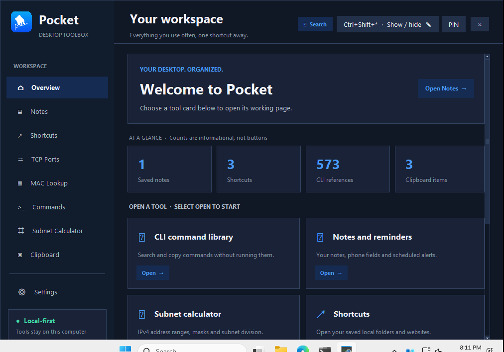
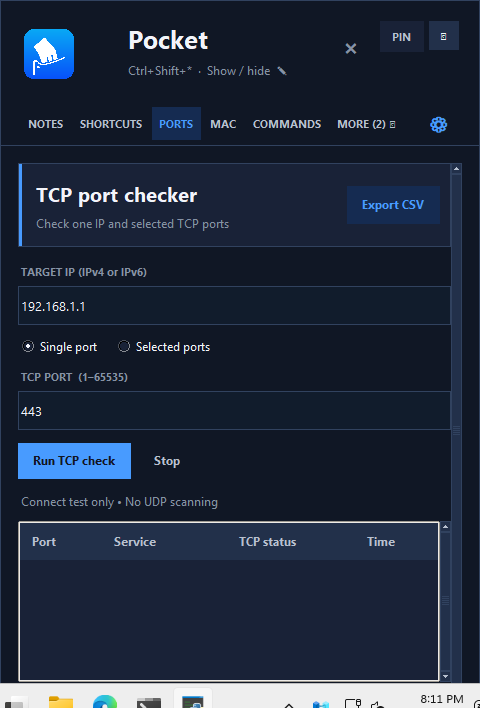
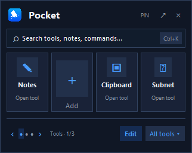
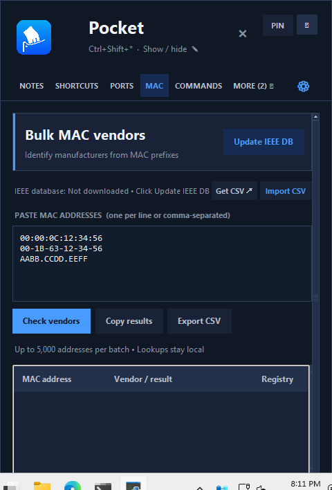
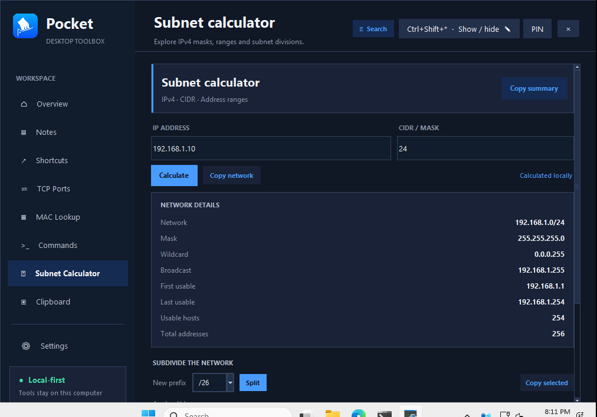
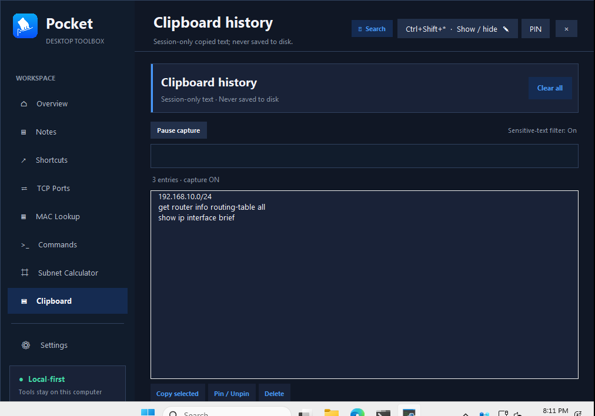
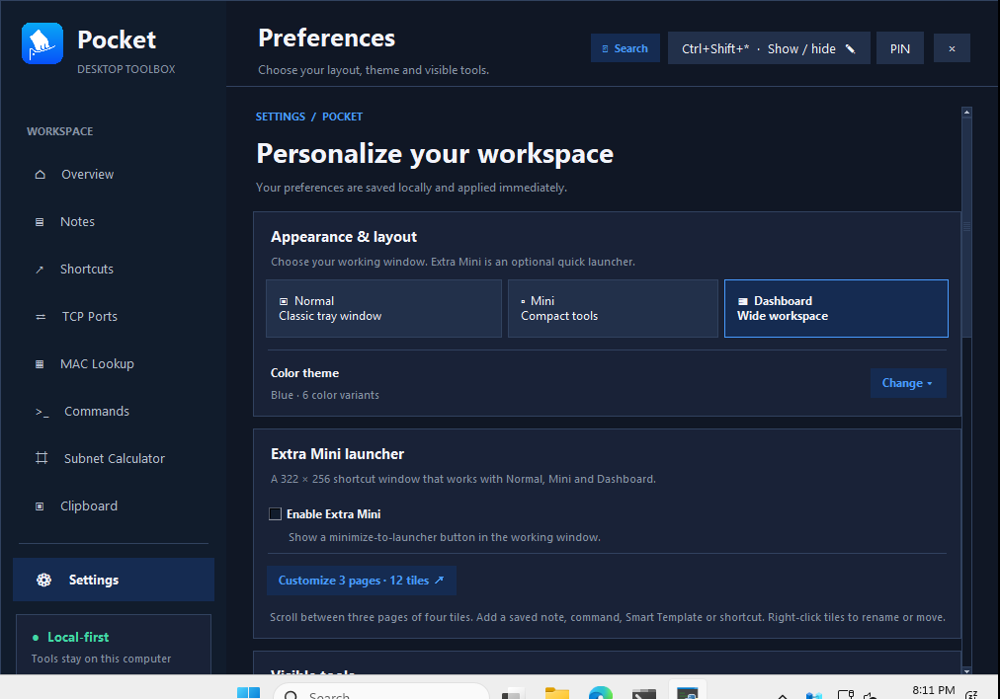

<div align="center">


# Pocket

**Your everyday Windows toolbox. One shortcut away.**

A lightweight, local-first toolkit for NOC/SOC work, network troubleshooting, notes, and everyday productivity.

[](https://github.com/Dovshmi/Pocket/releases/tag/v1.36.0)


[](LICENSE)

**[Download Portable ZIP](https://github.com/Dovshmi/Pocket/releases/download/v1.36.0/Pocket-Portable-v1.36.0.zip)** ·
**[Download Standalone EXE](https://github.com/Dovshmi/Pocket/releases/download/v1.36.0/Pocket-v1.36.0.exe)** ·
**[All Releases](https://github.com/Dovshmi/Pocket/releases)**

</div>

---

Pocket runs from the Windows system tray and opens on demand. It brings seven practical tools together in **Normal, Mini, Dashboard, and Extra Mini** layouts, with six color themes and customizable visible menus. Notes, CLI references, subnets, and clipboard history work without an internet connection; network access is initiated only when you request it.

> [!NOTE]
> **Version 1.36 (v1.36.0):** Native Windows input controls with standard editing shortcuts, better CLI/MAC scrolling and parsing, clearer Mini filters, and pinned Clipboard text at the top. Dropdowns retain their familiar click-to-select behavior—no typing-based filter. All existing offline tools and saved settings remain supported. [What's new](RELEASE_NOTES.md) · [Windows proxy details](docs/WINDOWS_PROXY.md).

## Development v1.37.0 — pending stable release

The [feature/pocket-next-updates](https://github.com/Dovshmi/Pocket/tree/feature/pocket-next-updates) branch contains improvements that are **not yet part of stable v1.36.0**:

- **Notes + Notepad:** New notes appear at the end of the list; the Note Title and its working TXT filename stay aligned. Renaming a note renames the corresponding file; duplicate names receive Windows-style numbered Titles and filenames such as *Router (1)* / *Router (1).txt*. Existing Notepad content is preserved on migration and conflicts.
- **Configurable Windows Proxy:** Under **Settings → Network connection**, *Use Windows Proxy* defaults to ON. DashDash MAC and TCP requests keep the existing working native Windows PAC/WinINet route when ON. OFF selects explicit direct HTTPS for DashDash. No global Windows proxy settings change.
- **IEEE MAC vendors:** **Update IEEE DB** now uses native Windows WinINet HTTPS GET in both modes. ON selects the existing Windows PAC resolver; OFF selects **direct WinINet with the Windows certificate trust store**, avoiding the Python SSL route that reported self-signed-certificate errors on some managed computers. TLS validation remains enabled; untrusted certificates will still fail. Incomplete downloads never overwrite the local cache, and manual CSV import remains available.
- **Clipboard RAM / DATABASE:** The Mini-friendly Storage and History date dropdowns let you switch between session-only RAM and persistent local history. DATABASE stores an **append-only daily TXT journal** and all PNG screenshots together in one flat folder (filenames contain date/time). **A compact 2×2 Settings grid selects how many items to display (10–100), not how many are saved**. Scroll the list or gallery to load older items without extra page buttons. Automatic deletion is **OFF by default**, optionally **7–30 days** for text and images. Old daily screenshot folders migrate without overwrites. [File layout, retention & privacy](docs/CLIPBOARD_DATABASE.md).
- **Translate keyboard repair:** Defaults to **enabled**, using **Mark** and `Ctrl+Alt+V`. You can now disable the global shortcut, edit its keys, and select Clipboard or Mark **all inside Settings → Clipboard & privacy**. Mark replaces selected text with the corrected EN/HE keyboard layout; Clipboard retains the original copy-and-convert workflow. Mark requires Windows and a supported Ctrl+C/Ctrl+V application.

These changes remain local-first. Mark does not use an online translator or require a persistent keyboard hook. [Windows proxy details](docs/WINDOWS_PROXY.md) · [Pending release notes](RELEASE_NOTES.md). Test before deploying at work, as a corporate PAC server and third-party app selection/paste behavior cannot be reproduced fully in CI.

## Screenshots

These are **real Pocket screenshots from Windows GUI tests** (not mockups). The images were captured in **v1.30.0**; later releases refined some layouts. See the [latest UI-test artifacts](https://github.com/Dovshmi/Pocket/actions/workflows/mini-checks.yml) for additional captures.

<div align="center">


**Dashboard**

<table>
<tr>
<td align="center"><br /><strong>Notes</strong></td>
<td align="center"><br /><strong>Commands</strong></td>
</tr>
<tr>
<td align="center"><br /><strong>TCP Port Checker</strong></td>
<td align="center"><br /><strong>Extra Mini</strong></td>
</tr>
</table>
</div>

<details>
<summary><strong>View more real app screenshots</strong></summary>

| Normal Notes | MAC Vendor Lookup | Mini Commands |
|:---:|:---:|:---:|
|  |  |  |

| Subnet Calculator | Clipboard | Dashboard Settings |
|:---:|:---:|:---:|
|  |  |  |

</details>

## Tools at a glance

| Tool | What it does | Connectivity |
| :--- | :--- | :--- |
| **Notes & reminders** | Titled notes with phone numbers, creation times, RTL/LTR editing, pin/duplicate, Notepad integration, and native Windows reminders | Offline |
| **Commands Helper** | Searchable CLI references by device/topic; edit, favorite, fill validated Smart Templates such as `{{IP}}`, then copy | Offline |
| **Quick Shortcuts** | Open websites, files, and Windows folders; group in collapsible Pocket folders, drag to reorder, or drop directly into a folder | Online only when you open a web link |
| **TCP Port Check** | Check up to **16 TCP ports** per run, with favorites, last-check suggestions, status sorting, and CSV export | Local or optional DashDash |
| **MAC Vendor Lookup** | Search cached IEEE registrations (MA-L, MA-M, MA-S, IAB), import CSV, or query DashDash | Local or optional DashDash |
| **Subnet Calculator** | IPv4 CIDR, masks, wildcard, network/broadcast, usable hosts, and subnet splitting | Offline |
| **Clipboard Manager** | Text and Images pages; compact storage/date controls and scroll-to-load history. RAM keeps 10–100 screenshots (20 default); opt-in DATABASE saves daily text and unlimited accepted dated PNGs in one folder, displaying 10–100 per page. Optional 7–30-day cleanup | Offline |

**Commands are references, not scripts:** Pocket never executes a saved CLI command. Smart Templates fill placeholders before copying; manual command backups are created **only when you choose Backup**.

**Reminders** use Windows tray notifications while Pocket is running or minimized to the tray, with overdue unsent reminders checked at the next launch. Hiding the Clipboard menu stops clipboard monitoring. **Clipboard RAM mode never writes history to disk**; optional DATABASE mode writes plaintext text and screenshots locally under `ClipboardDatabase/` in Pocket's user data directory. Sensitive-text filtering is heuristic, and database mode should only be enabled where permitted. [Clipboard database and retention details](docs/CLIPBOARD_DATABASE.md).

## New in Version 1.36 (v1.36.0)

- **Native Windows input:** More consistent Ctrl+A/C/X/V/Z and Pocket's own compact right-click editing menu, with corrected font sizing, text colors and vertical alignment. The specialized Notes editor retains its own handling.
- **MAC Lookup and CLI Commands:** Better support for complete switch-style MAC address dumps and long command text, with mouse-wheel scrolling when necessary and no permanent scrollbars.
- **TCP Port Checker:** Open/reachable results are presented before timed-out or closed ports.
- **Mini Commands layout:** The machine selector is on the **left**, category on the **right**, and the full-width CLI search below; selecting from a dropdown does not leave text highlighted afterward.
- **Clipboard:** Pinned text entries appear first without changing the saved pin state or the original copy order within each group.
- **Regular dropdowns:** No experimental type-to-search feature; open the list and choose normally.
- **Local-first:** No extra network requests are introduced by these editing improvements.

See [v1.36.0 release notes](RELEASE_NOTES.md) for verification and safe upgrade instructions.

## Fixed in v1.35.1

- Removed the three leading spaces before **unpinned Clipboard text entries** so items line up with the normal content inset.
- Replaced the Windows-native bright Clipboard focus frame with Pocket's subtle **1px themed border**.
- Fixed **Dashboard** navigation between scrollable and normal pages so content doesn't become nested or shift horizontally.
- Added regression checks of the content gutter across **all tools** in Normal, Mini and Dashboard.

Read the [v1.35.1 release history](https://github.com/Dovshmi/Pocket/releases/tag/v1.35.1) for details of that earlier release. The features below were introduced with v1.35.0 and remain available.

## New in v1.35.0

### Modern Settings and practical defaults

Settings now uses a consistent, responsive design in **Normal, Mini and Dashboard**, with visible theme swatches, accessible ON/OFF controls, and a compact author/version footer. **Mini** is the factory display mode, and new installations include the **Ushpelo** shortcut folder (DashDash and My GitHub) and Local TCP defaults `8.8.8.8` / `21,22,443,80,8080,3389,53`. **Existing profiles keep their mode, notes, shortcuts, and custom ports.** Pocket remembers the last active tool when it is still available.

### Clipboard and EN/HE keyboard repair

The familiar **Text / Images** view, Mini gallery, screenshot preview/copy workflow, and offline EN/HE keyboard repair were introduced in v1.35.0. In the pending **v1.37**, choose a **RAM capacity of 10–100** (20 default), or opt into the local DATABASE with independent **10–100 items shown per page** and optional 7–30-day cleanup. Its new default Translate shortcut is **Ctrl+Alt+V**, in **Mark** mode, with the ability to switch to Clipboard mode or disable the hotkey under Clipboard & privacy. This is keyboard-layout correction, not semantic translation.

### Notes, commands and visual polish

The native Windows Notes editor now transfers focus more reliably when you click Title or Phone; the white scrollbar is hidden, without losing mouse-wheel navigation through long notes. Unavailable context-menu actions remain readable with a strikethrough. Normal Commands shows at least four full results rows, and the Extra Mini shortcut is a small, opt-in **`_`** button. Pocket's header and Settings show **By. Rony Shmidov** and the current version.

See the [v1.35.0 release history](https://github.com/Dovshmi/Pocket/releases/tag/v1.35.0) for earlier features.

## Local vs. DashDash network checks

| Mode | Where the network check runs | Supported targets |
| :--- | :--- | :--- |
| **Local (default)** | On your Windows computer | TCP checks to reachable IPv4/IPv6, including private networks; MAC lookup from your local IEEE cache |
| **DashDash (opt-in)** | Pocket sends an HTTPS request to the DashDash API; the remote TCP test runs on Vercel | **Public IPv4 only** for TCP checks, up to 16 ports; remote MAC lookup up to 100 addresses |

- **Windows corporate networks:** for explicitly requested DashDash checks, Pocket uses the signed-in user's approved Windows proxy configuration, resolves PAC/WPAD for the destination, and sends HTTPS through the native Windows stack. There are no hard-coded workplace proxy settings, and certificate validation is not disabled.
- **No background scans:** switching modes does not run a check. Remote requests occur only after clicking **Run TCP check** or **Check vendors**. Offline tools do not depend on DashDash.
- **Know the source:** a DashDash TCP result measures reachability **from Vercel**, not from your work PC; use Local mode for internal networks. The DashDash API is public and has no Pocket account-level authentication. Only check targets you are authorized to test, and do not submit confidential customer or infrastructure data.

[How Windows Proxy/PAC works](docs/WINDOWS_PROXY.md)

## Window layouts and everyday controls

| Layout | Designed for |
| :--- | :--- |
| **Normal** | Everyday menu-based work |
| **Mini** | Compact workspace alongside other applications |
| **Dashboard** | Wider side-by-side tools and editing |
| **Extra Mini** | Optional quick-action launcher with customizable tiles and pages |

Pocket remembers window placement, last active tool and supports **Blue, Dark Blue, Black, Red, Green, and Purple** themes. Pin the popup to keep it open, or close it to hide it in the tray.

| Action | Shortcut / control |
| :--- | :--- |
| Show or hide Pocket | Tray icon or configurable global hotkey |
| Quick Search across enabled tools | `Ctrl+K` |
| Find commands while in Commands | `Ctrl+F` |
| New note | `Ctrl+N` |
| Save | `Ctrl+S` |
| Fully quit | Tray icon → **Exit** |

## Download and use

### Portable ZIP — recommended for a work PC

1. Download **[Pocket-Portable-v1.35.1.zip](https://github.com/Dovshmi/Pocket/releases/download/v1.36.0/Pocket-Portable-v1.36.0.zip)**.
2. **Extract the whole archive** into a writable local folder. Do not run the EXE inside the ZIP.
3. Launch `Pocket-Portable/PocketDesk.exe` and leave the `_internal/` folder beside it.
4. Choose a window layout and theme in Settings.

No Python installation is required. The portable version stores personal data under `Pocket-Portable/data/` beside the EXE. For upgrades, fully exit Pocket, back up `data/`, extract the new release into a **different** folder, and copy your personal `data/` folder over. Never mix old and new `_internal/` runtime files.

### Standalone EXE

Download **[Pocket-v1.35.1.exe](https://github.com/Dovshmi/Pocket/releases/download/v1.36.0/Pocket-v1.36.0.exe)** and run it directly. It stores its user data in `%APPDATA%\\PocketDesk\\` rather than beside the EXE.

> [!IMPORTANT]
> Releases are **unsigned**. Corporate application-control, antivirus, or proxy policies may block the program. Use Pocket only where authorized; do not disable workplace security controls. [Portable workplace troubleshooting](docs/WORKPLACE_PORTABLE.md).

## Privacy and data

Pocket has **no mandatory account, cloud sync, or continuous internet requirement**.

| Data | Storage |
| :--- | :--- |
| Notes, settings, reminders, shortcuts, launcher setup | Local `data.json` |
| Personal CLI commands and Smart Template metadata | Local `commands.json` |
| IEEE vendor cache | Local `vendors.json` |
| Clipboard history | **RAM by default**; optional daily text journal and flat PNG database, 10–100 displayed per page, OFF / 7–30-day cleanup |
| Recoverable settings snapshot | Local `data-recovery.json` |

Public Windows releases contain the **sanitized example command library only**—not private commands, notes, passwords, customer information, or backups. Pocket files are **not encrypted**, so protect your data folder and backups. Remote DashDash mode sends only the targets you explicitly submit; local lookups never upload them.

## Develop and contribute

**Stack:** Python 3.10+, Tkinter/ttk, native Windows APIs, Pillow, tkinterdnd2, and PyInstaller.

```powershell
git clone https://github.com/Dovshmi/Pocket.git
cd Pocket
py -3 -m pip install -r requirements.txt
py -3 app.pyw
```

**Tests and Windows packaging:**

```powershell
py -3 -m unittest discover -s tests -p "test_*.py" -v
.\build-portable.bat
.\build-exe.bat
```

GitHub Actions runs Windows/Linux regression checks, GUI smoke tests, and packaged Windows startup/integrity checks for releases. The portable build bundles its own Python runtime and only public example commands.

**Useful links:** [Release history](https://github.com/Dovshmi/Pocket/releases) · [Project layout](docs/REPOSITORY_LAYOUT.md) · [Report an issue](https://github.com/Dovshmi/Pocket/issues)

---

<div align="center">

**Pocket — small tools, one workspace.**

GPL-3.0 · Windows 10/11

</div>
