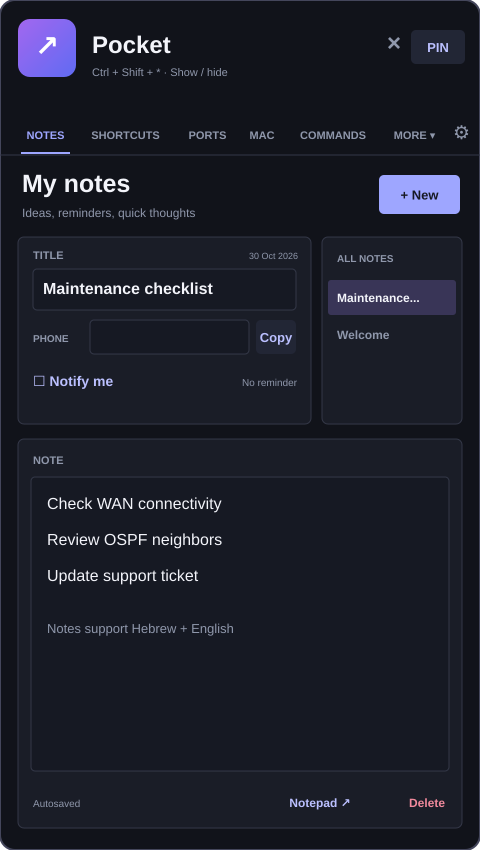
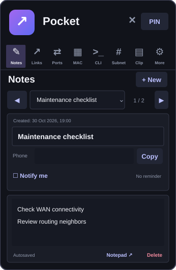
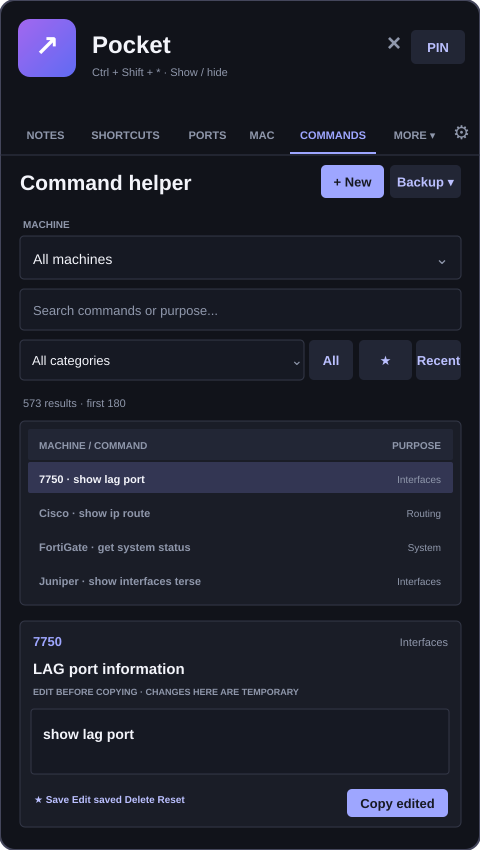
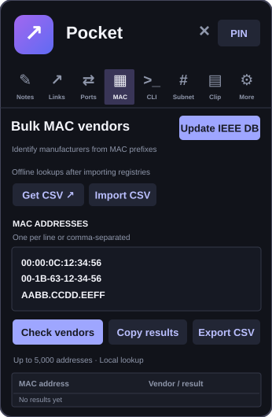
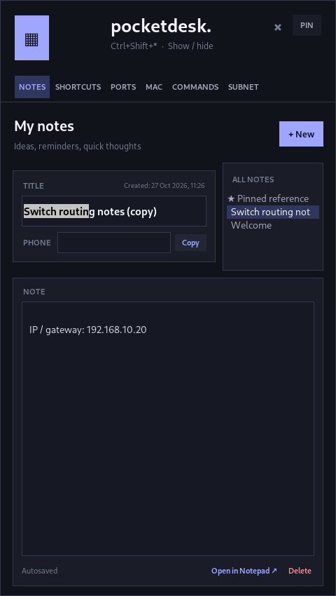
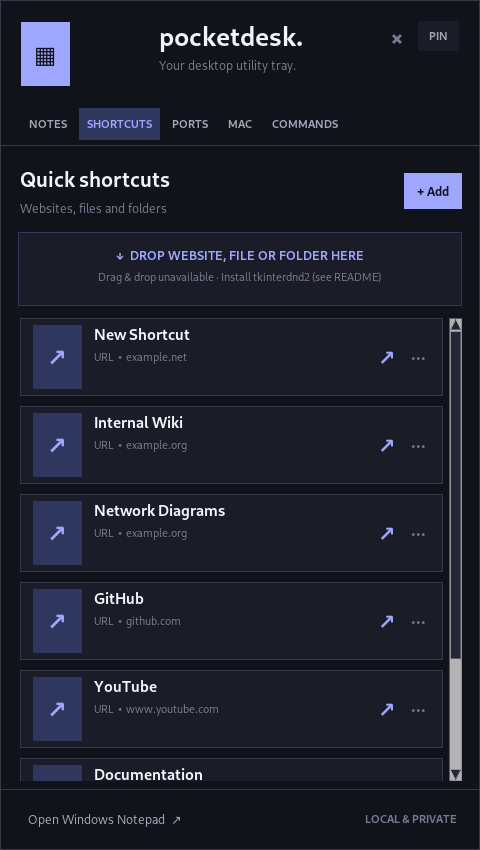
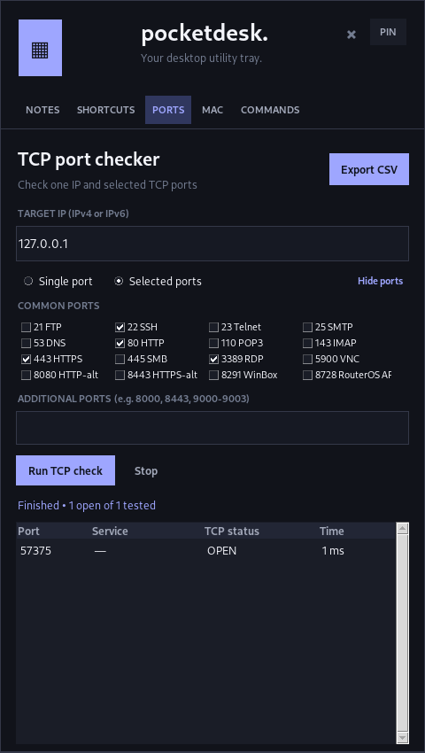

<div align="center">


# Pocket

### Your everyday Windows toolbox. One shortcut away.

**Notes · CLI references · TCP checks · MAC lookup · Subnets · Shortcuts · Clipboard**

A lightweight, customizable, **local-first Windows tray utility** that keeps practical tools close without requiring a browser tab, account or cloud service.

[](https://github.com/Dovshmi/Pocket/releases/tag/v1.29.1)


**[Download portable ZIP](https://github.com/Dovshmi/Pocket/releases/download/v1.29.1/Pocket-Portable-v1.29.1.zip)** · **[Download standalone EXE](https://github.com/Dovshmi/Pocket/releases/download/v1.29.1/Pocket-v1.29.1.exe)** · **[Release notes](https://github.com/Dovshmi/Pocket/releases/tag/v1.29.1)** · **[Report an issue](https://github.com/Dovshmi/Pocket/issues)**

</div>

---

> [!IMPORTANT]
> **Latest download:** **v1.29.1** includes the latest UI fixes previously available only in source: readable dropdowns, Dashboard Home scrolling, improved navigation, and keyboard/tooltips refinements. The source and Windows download now match this maintenance release.

## Why Pocket?

Pocket stays in the **Windows notification area** and appears only when you need it. It brings together seven everyday workflows, especially useful while troubleshooting networks, copying CLI syntax, keeping short notes, and opening repeat destinations.

- **Fast access:** Tray icon, configurable global hotkey, and compact launcher.
- **One application, four ways to navigate:** Normal, Mini and Dashboard working layouts, plus the optional Extra Mini launcher.
- **Offline-first:** Notes, commands, search, subnet calculations and cached vendor lookups are local. Network tests and vendor-database downloads are user initiated.
- **Your data stays local:** No Pocket account, hosted synchronization or telemetry service is required. Stored notes and settings are **not encrypted**, so treat the local data folder accordingly.
- **Predictable behavior:** Looking up a CLI command does **not** execute it. Saving an edited command does **not** make an automatic backup.

## Explore the interface

| Layout | Window | What it's designed for |
|:---|---:|:---|
| **Normal** | 480 × 850 | Everyday tray popup with familiar top navigation and **More** for additional enabled menus |
| **Mini** | 346 × 530 | Smaller working window with icon tabs, short tool views and keyboard paging |
| **Dashboard** | 1160 × 800 | Spacious workspace with a persistent left sidebar, information counters and quick-access cards for enabled tools |
| **Extra Mini** | 322 × 256 | **Optional launcher**, not a separate working layout; four editable tiles and search |

### How Extra Mini works

Choose a working layout under **Settings → Appearance & layout**. Enable **Extra Mini launcher**, then use the minimize-to-Extra-Mini control in the chosen working window.

```text
Normal / Mini / Dashboard
           │
           ▼  Minimize to Extra Mini
    Extra Mini launcher
     ◻ ◻ ◻ ◻  + search + All tools
           │
           ▼  Choose a tool
Same Normal / Mini / Dashboard layout
  → directly in the chosen tool
```

Extra Mini does **not** force you into Mini. Click the **expand** control to return to your previously open tool without selecting another one.

To edit the four tiles, click **Edit** in Extra Mini. Use **×** to clear a slot, then **+** to choose an enabled tool; **Done** exits editing. The positions remain fixed and changes are saved. You can also open the same editor from Settings. Any enabled tool remains accessible from **All tools**, even when it isn't one of the four tiles. Hiding a menu doesn't erase its saved tile preference.

### The current interface

> The illustrations below are **v1.28 concepts**, not screenshots of the current v1.29+ source interface. They are retained as layout references. Actual screenshots of earlier builds are available in the [historical gallery](#historical-screenshots).

<div align="center">
<table>
<tr>
<td align="center"><br/><strong>Normal · Notes (illustration)</strong></td>
<td align="center"><br/><strong>Mini · Notes (illustration)</strong></td>
</tr>
<tr>
<td align="center"><br/><strong>Normal · Commands (illustration)</strong></td>
<td align="center"><br/><strong>Mini · MAC lookup (illustration)</strong></td>
</tr>
</table>
</div>

## What's fixed in v1.29.1

This maintenance release updates the Windows binaries to include the improvements tested on `main`:

- Dark, readable Notes and Commands dropdowns (including their selection menus)
- Working mouse-wheel navigation and visible vertical scrollbar on Dashboard Home
- Clearer separation of Dashboard information counters and clickable tool cards
- More discoverable Normal/Mini navigation and keyboard-accessible Extra Mini controls
- The same notes, CLI, network, search and clipboard functionality as v1.29

See the [release notes](https://github.com/Dovshmi/Pocket/releases/tag/v1.29.1) for upgrade instructions and limitations.

## Seven tools, one window

| Tool | What you can do |
|:---|:---|
| **Notes & reminders** | Create and autosave notes; store titles, phone numbers and creation timestamps; pin, duplicate or delete notes; choose RTL/LTR direction; edit a note in Windows Notepad; set one-time reminders |
| **Commands** | Search a local network-CLI library by machine, category, command or purpose (including Hebrew); edit and copy commands; add custom entries, mark favorites, browse recent items, and manually back up or restore the library |
| **Shortcuts** | Save links to websites, local folders and files; open or copy targets; search your saved shortcuts; drag a file, folder or web address into a review form when supported |
| **TCP Ports** | Test individual ports or lists/ranges against an IPv4 or IPv6 destination; inspect OPEN/CLOSED/TIMEOUT/ERROR outcomes and copy/export results |
| **MAC Lookup** | Identify IEEE OUI vendor assignments from one or several MAC addresses; update or import IEEE CSV data; use cached data offline; export results |
| **Subnet Calculator** | Calculate IPv4 network/broadcast addresses, subnet masks, wildcards, usable host ranges and counts; divide a network into smaller subnets, including /31 and /32 handling |
| **Clipboard History** | Capture copied text while enabled, search within the session, pin or copy entries, delete individual items or clear history; pause/resume capture and optionally filter recognized secrets |

### Notes that fit technical work

Notes have a title, optional phone number, creation time and a full text editor. They support pinning, duplication, right-click actions, timestamp insertion and a selectable text direction. The native Windows Unicode editor is designed for mixed RTL/LTR text, including Hebrew and English. **Open in Notepad** uses a stable local working file so saved Notepad edits can be synchronized back into Pocket, with conflict handling if both editors changed the note.

**One-time reminders** are attached to individual notes. Set a local date/time, leave Pocket running in the tray and receive a Windows notification. If Pocket isn't running at the scheduled time, it checks for overdue unsent reminders on the next launch. Reminder appearance and click behavior depend on Windows notification settings.

### CLI library — copy, don't execute

The Commands menu is a **reference and editing workspace**, not a terminal or remote executor. Search by device and category, then select, edit, copy, save or favorite a command. Mini presents a compact one-result-at-a-time view; Normal/Dashboard provide a result list and an editable detail area.

**Backups are manual by design.** Use **Commands → Backup → Create new backup** when you want a copy. **Use existing backup** restores a chosen library; restoring replaces the active command collection. Normal edits do not create a backup at every save. Custom library content is kept in the writable local `commands.json`.

### Network utilities — on demand

The Subnet Calculator computes addresses without a network connection. TCP checks contact **only** the destination you specify when you start a check. MAC Lookup uses a locally cached or imported IEEE vendor registry; updating the registry needs internet access and may be blocked by a corporate firewall or the IEEE servers. The UI includes a manual **Get CSV → Import CSV** path.

Only run network checks against systems you are authorized to test. A port timeout is not proof that a service is closed, and an OUI prefix identifies a registered vendor rather than an exact device owner.

## Search, personalization and controls

### Quick Search

Press **Ctrl+K** from Normal, Mini or Dashboard to search your **enabled menus**, saved notes, saved shortcuts and CLI references. Select a result to open it in its existing Pocket tool. Search is local and does not automatically execute commands or open shortcut URLs. Extra Mini has an inline search field.

**Ctrl+F** focuses the command search while you're in Commands; elsewhere it opens Quick Search.

### Settings

- **Appearance & layout:** Normal, Mini or Dashboard, plus one of six icon and color themes — **Blue, Dark Blue, Black, Red, Green, Purple**.
- **Extra Mini:** Toggle the small launcher on/off and configure its four quick-access tiles in place.
- **Visible tools:** Show or hide any of the seven menus without deleting its underlying notes, commands or shortcuts.
- **Keyboard shortcut:** Configure the system-wide popup hotkey; if a requested combination can't be registered, Pocket preserves the previous usable one.
- **Clipboard privacy:** Pause capture and enable/disable a conservative sensitive-text filter.

Pocket also remembers window positions separately for each layout. Drag the header to move the popup; use the header's reset-position control if it ends up off-screen. **PIN** keeps Pocket visible when you're working in another window. Closing the popup normally **hides it to the tray**, rather than quitting or erasing data.

### Keyboard and navigation

| Action | Shortcut / control |
|:---|:---|
| Open Quick Search | `Ctrl+K` |
| Search Commands when on that page | `Ctrl+F` |
| Create a new note | `Ctrl+N` |
| Save current state | `Ctrl+S` |
| Show / hide Pocket | Configurable **global hotkey** or tray icon |
| Navigate Mini note/command cards | Arrow keys when the editor/search input does not have focus |
| Navigate menus | Mouse or keyboard Tab, then Enter/Space where supported |
| Return from Extra Mini | Click a tool tile or its expand control |

## Clipboard privacy — important

Clipboard collection follows the **Clipboard menu visibility** setting. When its menu is enabled and capture is not paused, Pocket records newly copied text even if the window is hidden in the tray. History stays **in memory only** and disappears on exit; it is **not written to `data.json`**.

Pause Capture stops collecting new entries. The optional sensitive-text filter tries to skip common password assignments, bearer tokens, API keys and private-key markers. **It cannot reliably detect every secret.** For confidential tasks, pause capture or hide Clipboard completely, then clear the in-memory history. Pocket does not remove contents from the Windows system clipboard or Windows' own clipboard-history feature.

## Download, install and update

### Option 1 — Portable ZIP (recommended)

**[Pocket-Portable-v1.29.1.zip](https://github.com/Dovshmi/Pocket/releases/download/v1.29.1/Pocket-Portable-v1.29.1.zip)**

1. Download and extract the **entire** ZIP to a writable folder.
2. Launch `PocketDesk.exe` from the extracted folder (not from inside the ZIP).
3. Find Pocket in the system tray and choose the layout you want under Settings.

Portable mode uses the included `portable.flag` marker to keep application data in the adjacent `data/` directory. It does not require Python on the destination computer. Moving the whole folder moves the application and its data together.

### Option 2 — Standalone executable

**[Pocket-v1.29.1.exe](https://github.com/Dovshmi/Pocket/releases/download/v1.29.1/Pocket-v1.29.1.exe)**

Run the EXE directly. Python installation is unnecessary, but this build stores its data in the regular Windows application-data location, **not beside the EXE**.

> [!CAUTION]
> Both public executables are **unsigned**. Windows SmartScreen or your organization's application policies may restrict them. Use Pocket only on computers where you are authorized to run it. The portable version does not bypass those policies.

### Keep your data when upgrading

Exit Pocket completely from the tray first. **Back up your data folder** before updating. For a portable installation, extract the new application files and **preserve your existing `data/` directory**. Don't overwrite it with an empty folder or mix an old `_internal/` folder into a new build. Back up any custom command library separately if it matters.

The public portable ZIP contains a **public example command library**, not your personal notes, copied text or custom command backups.

### Run the latest source code

The v1.29.1 source matches the published Windows binaries at its release tag. Development changes to main after this release may require building from source.

**Requirements:** Windows 10/11 and Python 3.10+ with Tkinter.

```powershell
git clone https://github.com/Dovshmi/Pocket.git
cd Pocket
.\install.bat
.\run.bat
```

Or start directly after installing dependencies:

```powershell
py -3 -m pip install -r requirements.txt
py -3 app.pyw
```

A Windows development PC can also run `build-portable.bat` to create a portable build from source. Python and build dependencies are required **on the build machine**.

## Storage, offline use and safety

| Item | Behavior |
|:---|:---|
| Notes, reminders, links, preferences | Local `data.json` |
| Custom CLI library | Local writable `commands.json` |
| MAC vendor assignments | Local `vendors.json` cache/import |
| Notepad working copies | Local `notepad/` directory |
| Clipboard history | **RAM only; not saved to disk** |
| Standard installation | `%APPDATA%\PocketDesk\` |
| Portable installation | `Pocket-Portable\data\` beside the executable |

Pocket does **not encrypt** saved notes, phone numbers, command content or other JSON files. Don't put passwords, private keys, customer secrets or restricted workplace documentation in those files. Review and sanitize screenshots, issue attachments and command collections before publishing them.

Internet access is **not needed** to read/write notes, search local references, calculate subnets, or navigate Pocket. Explicit TCP checks require destination connectivity; IEEE downloads require external access. The app does not provide cloud sync.

Pocket is designed to maintain **one running instance per signed-in Windows session**. Starting it again normally activates the existing popup rather than running a second process that might overwrite local data. Preview mode for development tests is treated differently.

## Build, test and contribute

The app uses **Python/Tkinter/ttk**, native Windows APIs through `ctypes`, Pillow, `tkinterdnd2`, and PyInstaller for Windows packaging.

```text
Pocket/
├── app.pyw                Main window, tools, tray and UI dispatch
├── pocket_design.py       Theme-aware reusable controls
├── dashboard_ui.py        Wide Dashboard and home cards
├── compact_dashboard.py   Extra Mini launcher, search and tile editor
├── settings_ui.py         Modern settings panels
├── mini_layout.py         Layout sizes and saved window positions
├── command_helper.py      CLI search / filtering
├── command_store.py       Command storage and manual backups
├── quick_search.py        Local multi-tool search
├── clipboard_policy.py    Optional sensitive-text capture filter
├── native_bidi.py         Native Windows Unicode/RTL editor
├── note_sync.py           Notepad synchronization
├── network_tools.py       TCP tests and vendor lookup
├── subnet_calculator.py   IPv4 calculations
├── portable_storage.py    Folder-local portable mode
├── icon_themes.py         Six saved icon/color palettes
├── commands/              Public example and local library files
├── docs/images/           Historical UI illustrations
├── test_*.py              Automated regression tests
└── .github/workflows/     Windows/Linux tests and releases
```

Run the unit tests:

```powershell
py -3 -m unittest discover -v
```

The repository also contains real Tk GUI smoke tests for Normal/Mini/Dashboard, Extra Mini tile editing, theme and dropdown readability, and Dashboard scrolling. CI runs on Windows and Linux and verifies the Windows portable package. **Passing CI doesn't replace hands-on testing** of real Windows tray behavior, right-to-left text editing, display scaling, multi-monitor movement and native menus.

**Packaging caution:** `build-exe.bat` is intended for personal/local builds and can bundle a local `commands/commands.json`, which may contain private entries. Review it before distributing anything. Public release automation instead packages the **public example command library**.

Found a bug or have an idea? [Open an issue](https://github.com/Dovshmi/Pocket/issues). Include reproduction steps and Windows version, but remove personal notes, passwords, customer data and private network details first.

## Version history

| Milestone | Highlights |
|:---|:---|
| **v1.29.1 — published** | Readable dark dropdown selections, scrollable Dashboard Home, clearer tool-card navigation, focusable menus and improved tooltips; updated portable ZIP and standalone EXE |
| **v1.29** | Wide Dashboard, optional editable Extra Mini launcher, modern Settings/design system, global Quick Search, clipboard Pause/Resume and heuristic sensitive-text filtering; standalone EXE and portable ZIP |
| **v1.28** | Public portable packaging, single-instance Windows startup, Normal/Mini improvements |
| **v1.27** | Mini tools, icon tabs, keyboard paging and tool scrolling |
| **v1.26** | Native mixed-direction note editing and Notepad sync |
| **v1.24–v1.25** | Clipboard, menu visibility, reminders and manual command backup/restore |
| **Earlier** | Notes, commands, shortcuts, subnet calculation, network tools, custom themes and saved window position |

See [all GitHub releases](https://github.com/Dovshmi/Pocket/releases) and the [commit history](https://github.com/Dovshmi/Pocket/commits/main). **Smart Command Templates are a planned future upgrade**, not an implemented feature in this version.

### Historical screenshots

These are **real screenshots of older versions**, retained as historical references. They are not proof of the current layout's exact appearance.

| Notes | Shortcuts | Network tools |
|:---:|:---:|:---:|
|  |  |  |

## License

Pocket is released under the [GNU General Public License v3.0](LICENSE).

---

<div align="center">

**Pocket — all the small tools you reach for, in one place.**

[Back to top](#pocket)

</div>
