<div align="center">


# Pocket

### Your everyday Windows toolbox. One shortcut away.

**Notes · CLI references · TCP checks · MAC lookup · Subnets · Shortcuts · Clipboard**

A lightweight, customizable, **local-first Windows tray utility** that keeps practical tools close without requiring a browser tab, account or cloud service.

[](https://github.com/Dovshmi/Pocket/releases/tag/v1.31.0)


**[Download portable ZIP](https://github.com/Dovshmi/Pocket/releases/download/v1.31.0/Pocket-Portable-v1.31.0.zip)** · **[Download standalone EXE](https://github.com/Dovshmi/Pocket/releases/download/v1.31.0/Pocket-v1.31.0.exe)** · **[Release notes](https://github.com/Dovshmi/Pocket/releases/tag/v1.31.0)** · **[Report an issue](https://github.com/Dovshmi/Pocket/issues)**

</div>

---

> [!IMPORTANT]
> **Latest stable release:** **v1.31.0** adds adaptive Extra Mini pages, improved quick-action selection, refreshed Normal navigation and layout density, reliable Notes focus and consistent icons. Smart Command Templates remain included. Close Pocket and back up your portable `data/` directory and personal `commands.json` before upgrading.

## Why Pocket?

Pocket stays in the **Windows notification area** and appears only when you need it. It brings together seven everyday workflows, especially useful while troubleshooting networks, copying CLI syntax, keeping short notes, and opening repeat destinations.

- **Fast access:** Tray icon, configurable global hotkey, and compact launcher.
- **One application, four ways to navigate:** Normal, Mini and Dashboard working layouts, plus the optional Extra Mini launcher.
- **Offline-first:** Notes, commands, search, subnet calculations and cached vendor lookups are local. Network tests and vendor-database downloads are user initiated.
- **Your data stays local:** No Pocket account, hosted synchronization or telemetry service is required. Stored notes and settings are **not encrypted**, so treat the local data folder accordingly.
- **Predictable behavior:** Looking up a CLI command does **not** execute it. Saving an edited command does **not** make an automatic backup.

## Explore the interface

| Layout | Window | What it's designed for |
|:---|---:|:---|
| **Normal** | 480 × 850 | Everyday tray popup with familiar top navigation and **More** for additional enabled menus |
| **Mini** | 346 × 530 | Smaller working window with icon tabs, short tool views and keyboard paging |
| **Dashboard** | 1160 × 800 | Spacious workspace with a persistent left sidebar, information counters and quick-access cards for enabled tools |
| **Extra Mini** | 322 × 256 | **Optional launcher** with four quick actions per page, adding pages automatically as needed, and search |

### How Extra Mini works

Choose a working layout under **Settings → Appearance & layout**. Enable **Extra Mini launcher**, then minimize the working window into the launcher.

```text
Normal / Mini / Dashboard
           │
           ▼  Minimize to Extra Mini
       Extra Mini launcher
     Page 1  ●  (up to 4 actions)
     ◻ ◻ ◻ ◻
           │  Add action 5 in Edit
           ▼
     Page 2  ● ●  (actions 5–8)
     ◻ ◻ ◻ ◻
           │  Add more actions as needed
           ▼
     More pages appear automatically
           │
           ▼  Open selected item
Same Normal / Mini / Dashboard layout
  → directly to a note, command or tool```

Extra Mini does **not** force you into Mini. The **expand** control restores your previous working layout without choosing a new action.

In v1.31.0, use **‹ / ›**, the mouse wheel, or the page dots to switch between pages, which appear **as you add actions in groups of four**. Click **Edit**, then **+** to choose a tool or an exact saved item; the footer + control is hidden outside Edit mode. Right-click an existing tile to **Replace**, **Rename**, **Move** or **Remove** it; use **Done** when finished. Right-click the page label (or click it during Edit) to rename the page. Previously configured tiles remain on page one. The other pages initially start empty.

Quick actions can open an exact **note**, **command**, **approved Smart Template**, or **saved shortcut**, in addition to menu tools. A regular command can optionally be copied directly but is **never executed**. **All tools** remains available even when it isn't in one of the launcher slots. Hiding a menu does not erase its tile preference.

### Pocket v1.30.0 reference screenshots (previous stable layout)

These are **actual captures of Pocket v1.30.0 running in Windows GUI tests**, not illustrations or renders. The v1.31.0 navigation and density improvements are newer than these screenshots. Fresh Windows GUI screenshots are available as build artifacts in [Pocket Actions](https://github.com/Dovshmi/Pocket/actions/workflows/mini-checks.yml). Test profiles contain sample data, never private notes.

<div align="center">
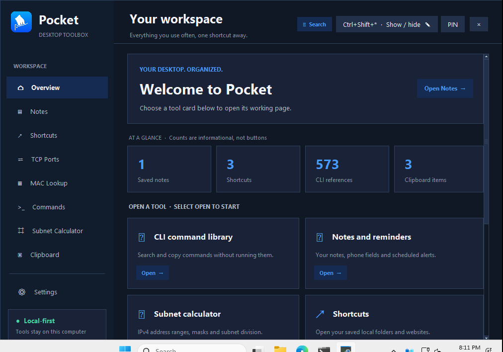
<br /><strong>Dashboard · Home</strong>
</div>

### Work in Dashboard mode

<div align="center">
<table>
<tr>
<td align="center">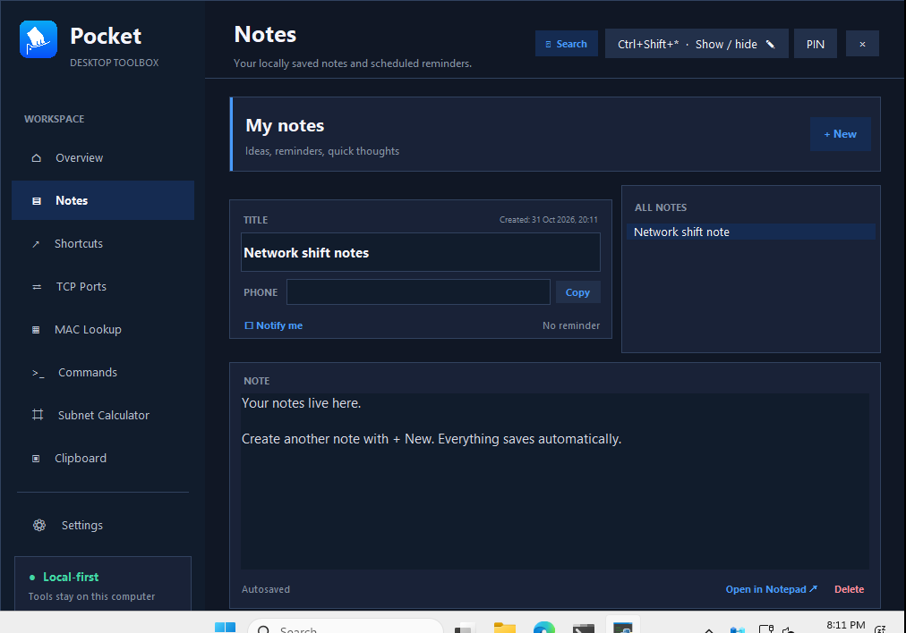<br /><strong>Notes</strong></td>
<td align="center">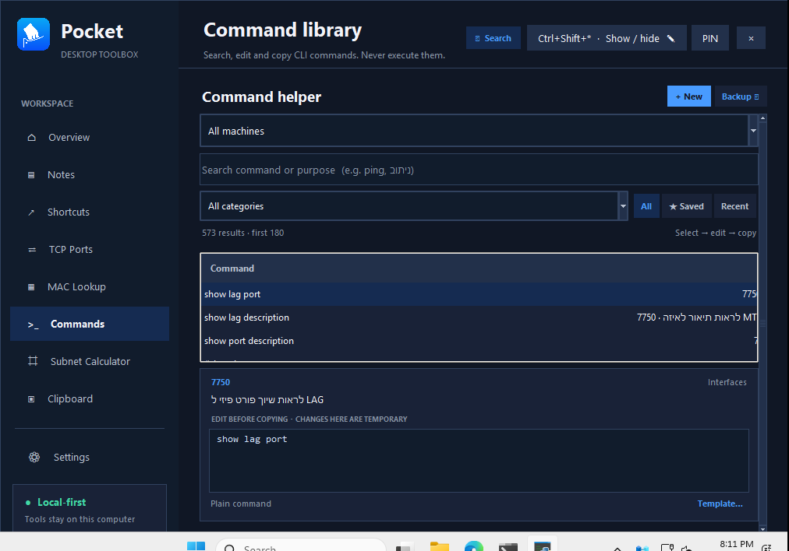<br /><strong>CLI Commands &amp; Templates</strong></td>
</tr>
<tr>
<td align="center">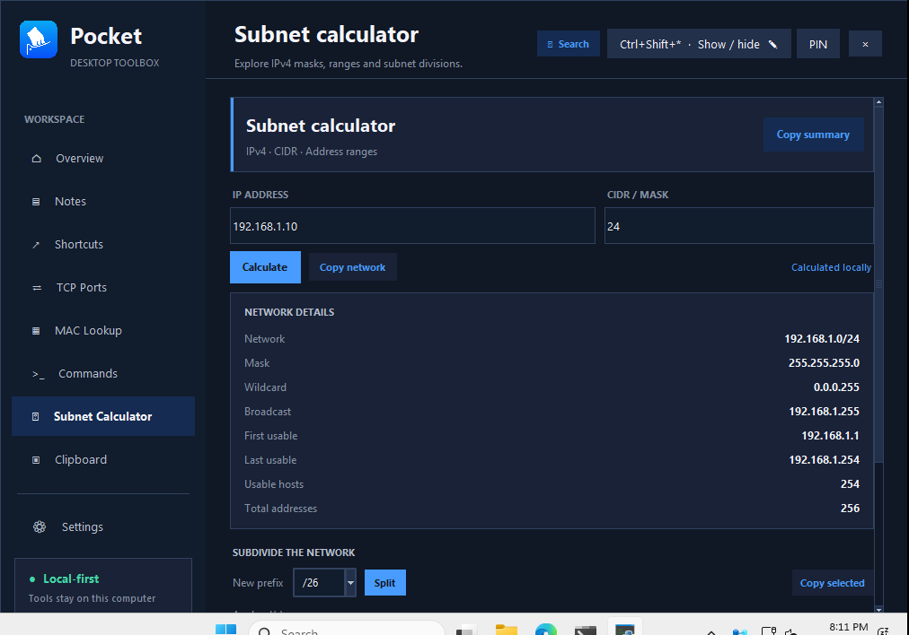<br /><strong>Subnet Calculator</strong></td>
<td align="center">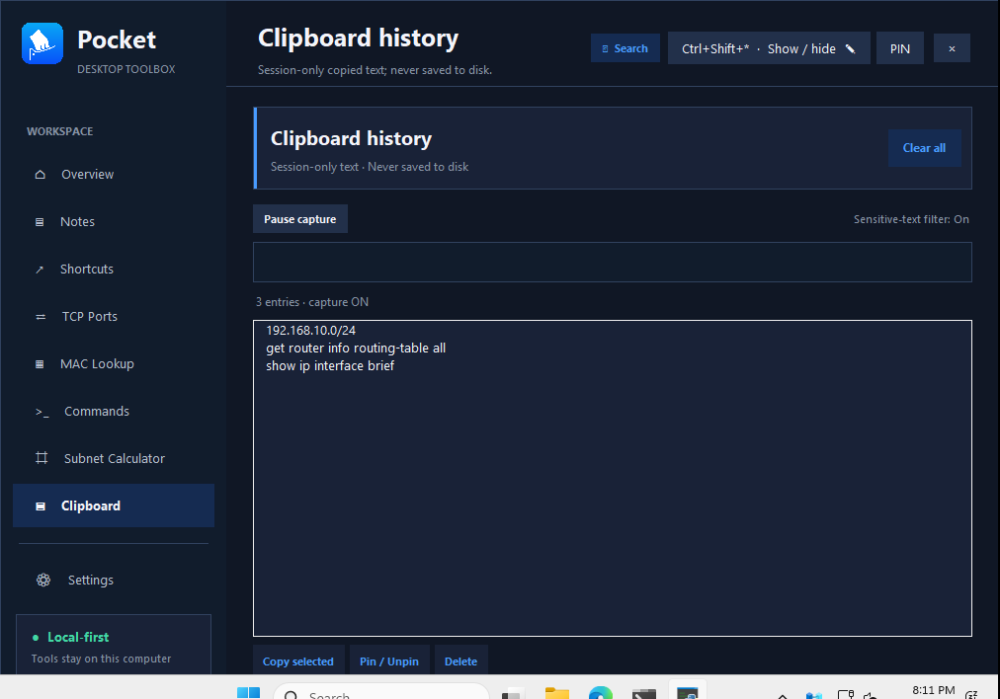<br /><strong>Clipboard History</strong></td>
</tr>
</table>
</div>

### Normal mode — everyday tools

<div align="center">
<table>
<tr>
<td align="center">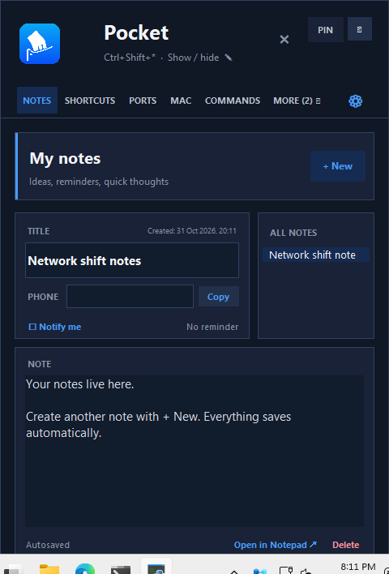<br /><strong>Notes</strong></td>
<td align="center">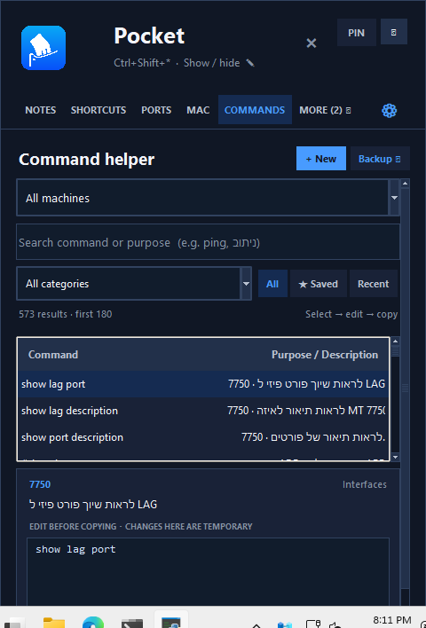<br /><strong>Commands</strong></td>
</tr>
<tr>
<td align="center">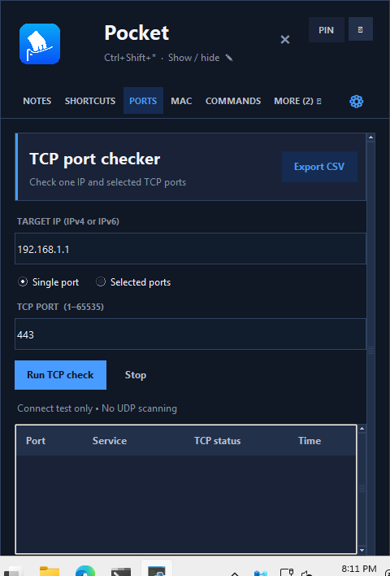<br /><strong>TCP Ports</strong></td>
<td align="center">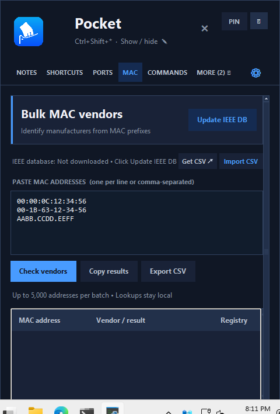<br /><strong>MAC Lookup</strong></td>
</tr>
</table>
</div>

### Compact layouts

<div align="center">
<table>
<tr>
<td align="center">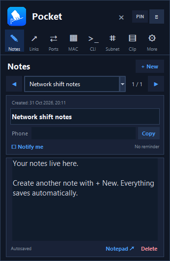<br /><strong>Mini · Notes</strong></td>
<td align="center">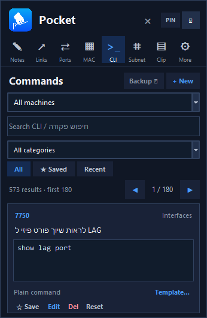<br /><strong>Mini · Commands</strong></td>
<td align="center">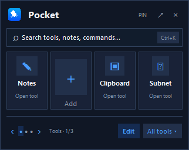<br /><strong>Extra Mini · Launcher</strong></td>
</tr>
</table>
</div>

<details>
<summary><strong>Settings and more screenshot files</strong></summary>

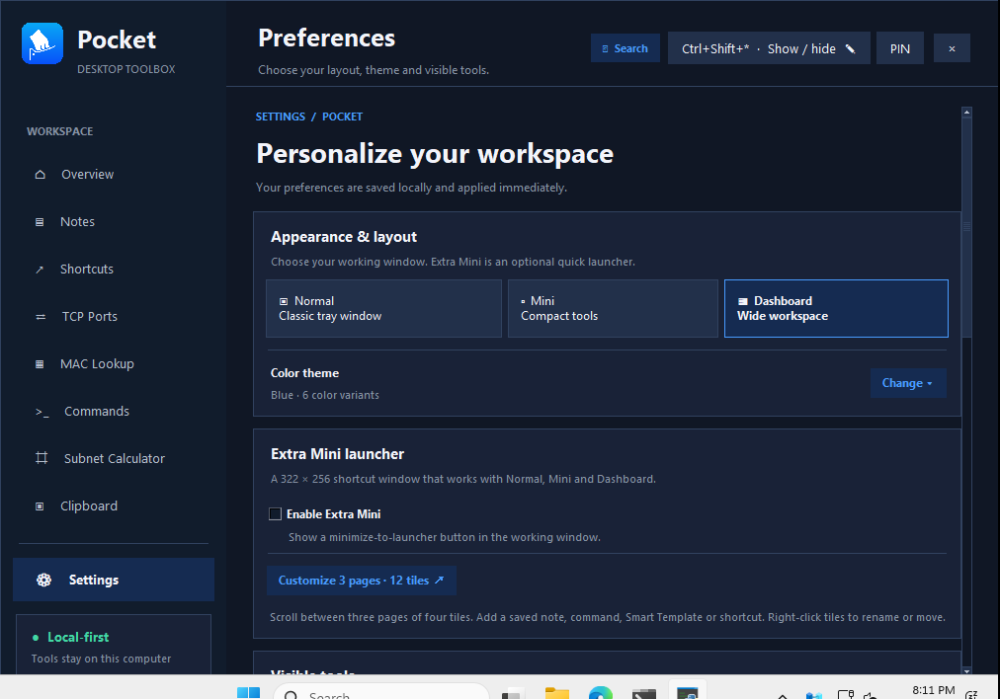

The screenshots shown above come from the automated **Windows GUI smoke test**, using an isolated temporary profile. The CI workflow also captures the Shortcuts page, additional network tools, and each page under Normal, Mini and Dashboard. Find the complete latest Windows and Linux screenshot archives in the [Pocket regression checks Actions runs](https://github.com/Dovshmi/Pocket/actions/workflows/mini-checks.yml) under **pocket-ui-Windows** and **pocket-ui-Linux**.

</details>

## UI improvements retained from v1.29.1

This maintenance release updates the Windows binaries to include the improvements tested on `main`:

- Dark, readable Notes and Commands dropdowns (including their selection menus)
- Working mouse-wheel navigation and visible vertical scrollbar on Dashboard Home
- Clearer separation of Dashboard information counters and clickable tool cards
- More discoverable Normal/Mini navigation and keyboard-accessible Extra Mini controls
- The same notes, CLI, network, search and clipboard functionality as v1.29

See the [release notes](https://github.com/Dovshmi/Pocket/releases/tag/v1.29.1) for upgrade instructions and limitations.

## Extra Mini quick-action pages (introduced in v1.30.0; expanded in v1.31.0)

> v1.30.0 introduced three fixed pages. **v1.31.0 shows only pages needed for saved actions:** one page for up to four, two for five through eight, three for nine through twelve, and additional pages as needed.

**Extra Mini stays 322 × 256** with four tiles per page. Your existing saved references are retained; empty trailing pages are hidden. Page names, the selected page and tile assignments are saved locally.

- **Switch pages:** scroll the mouse wheel over the launcher, click the ‹/› arrows, or click a page dot. The last selected page remains active after closing and reopening Extra Mini.
- **Edit / Done:** click **Edit**, then **+** on a blank slot or the footer **+** (which appears only while editing) to open the interactive searchable picker with category choices. Choose a **Pocket tool**, **specific saved command**, **approved Smart Template**, **specific note**, or **saved shortcut**. Nothing is added until you confirm.
- **Right-click a tile:** Open, Replace, Rename, Move, or Remove. A rename changes only its launcher label. Drag a tile to another slot to swap it; to move between pages, scroll while dragging or use the accessible **Move to another slot** picker.
- **Rename a page:** right-click the page name in the launcher footer and enter a short label.
- **Behavior:** Tool tiles open the selected menu; note tiles select that exact note; command tiles open the exact CLI reference, or optionally copy its text directly; Smart Template tiles open the existing validated Fill & Copy form; shortcut tiles open the saved file, folder or URL **only when clicked**. No CLI is ever executed.
- **Safe missing/hidden items:** deleted notes, shortcuts, commands or hidden menus appear unavailable instead of opening another record. Configurations are retained so you can restore or replace them. Unapproved/stale Smart Templates cannot generate output.
- **Search:** remains global and separate from page switching. Extra Mini still returns to the user's chosen Normal, Mini, or Dashboard layout.

The existing `extra_mini_tiles` preference is mirrored for backwards compatibility. New reference/page metadata is stored locally in `data.json`; clipboard contents and generated template input values are not persisted.

---

## Smart Command Templates (v1.30.0)

> **Optional feature:** Smart Templates were introduced in **v1.30.0** and remain available in **v1.31.0**. Ordinary commands still work without templates.

Pocket's Commands screen now has a small **Template…** option for a selected command. Your ordinary **Copy edited**, editing, search, categories, favorites, recent history, command backups, and plain-command behavior continue unchanged.

1. Select a command in **Normal**, **Mini**, or **Dashboard**, then choose **Template…**. Pocket may suggest fields for recognizable placeholders (`{vrf}`, `<IP>`, `[interface]`, `x.x.x.x`, `x/x/x`, and a few other forms). Suggestions do not modify the library.
2. Review the suggested format using **`{{FIELD_NAME}}`** markers, then click **Refresh fields**. The editor shows only **how many fields were detected**, not a long form of field editors. For more control, open the optional **Field options** disclosure to adjust a label, validation type (IPv4/IPv6, CIDR, VLAN, port, VRF, interface, MAC, integer, choice, free text), or choice values. Refresh collapses those advanced controls again without discarding their saved settings.
3. Click **Save template** to add metadata to that command in your writable `commands.json`. This **does not** overwrite the original CLI text, create a backup, or affect other commands.
4. The command then shows **Fill & copy**. Enter the values, review the generated CLI, then click **Copy command**. Pocket copies the result to the clipboard **without executing it or saving the entered values**. The normal Copy action remains available.
5. To disable the feature for one command, select **Template… → Remove**. The saved original command and other command functions remain intact.

**Important:** Suggestions are heuristic—not a CLI syntax validator. Some library entries are notes, alternative commands, fixed examples, or multiple CLI steps. These require manual review, and incorrect suggestions should be corrected or discarded. If you edit the underlying command after approving a template, Pocket marks its template **Needs review** and disables generated copying until you approve an updated format. Templates follow the existing **manual** command backup/restore workflow and store no filled-in input values on disk.

Extra Mini can now open a **specific approved Smart Template** directly in whichever working mode you selected; there is no extra top-level menu. Smart Templates work entirely offline.

---

## Seven tools, one window

| Tool | What you can do |
|:---|:---|
| **Notes & reminders** | Create and autosave notes; store titles, phone numbers and creation timestamps; pin, duplicate or delete notes; choose RTL/LTR direction; edit a note in Windows Notepad; set one-time reminders |
| **Commands** | Search a local network-CLI library by machine, category, command or purpose (including Hebrew); edit and copy commands; add custom entries, mark favorites, browse recent items, and manually back up or restore the library |
| **Shortcuts** | Save links to websites, local folders and files; open or copy targets; search your saved shortcuts; drag a file, folder or web address into a review form when supported |
| **TCP Ports** | Test individual ports or lists/ranges against an IPv4 or IPv6 destination; inspect OPEN/CLOSED/TIMEOUT/ERROR outcomes and copy/export results |
| **MAC Lookup** | Identify IEEE OUI vendor assignments from one or several MAC addresses; update or import IEEE CSV data; use cached data offline; export results |
| **Subnet Calculator** | Calculate IPv4 network/broadcast addresses, subnet masks, wildcards, usable host ranges and counts; divide a network into smaller subnets, including /31 and /32 handling |
| **Clipboard History** | Capture copied text while enabled, search within the session, pin or copy entries, delete individual items or clear history; pause/resume capture and optionally filter recognized secrets |

### Notes that fit technical work

Notes have a title, optional phone number, creation time and a full text editor. They support pinning, duplication, right-click actions, timestamp insertion and a selectable text direction. The native Windows Unicode editor is designed for mixed RTL/LTR text, including Hebrew and English. **Open in Notepad** uses a stable local working file so saved Notepad edits can be synchronized back into Pocket, with conflict handling if both editors changed the note.

**One-time reminders** are attached to individual notes. Set a local date/time, leave Pocket running in the tray and receive a Windows notification. If Pocket isn't running at the scheduled time, it checks for overdue unsent reminders on the next launch. Reminder appearance and click behavior depend on Windows notification settings.

### CLI library — copy, don't execute

The Commands menu is a **reference and editing workspace**, not a terminal or remote executor. Search by device and category, then select, edit, copy, save or favorite a command. Mini presents a compact one-result-at-a-time view; Normal/Dashboard provide a result list and an editable detail area.

**Backups are manual by design.** Use **Commands → Backup → Create new backup** when you want a copy. **Use existing backup** restores a chosen library; restoring replaces the active command collection. Normal edits do not create a backup at every save. Custom library content is kept in the writable local `commands.json`.

### Network utilities — on demand

The Subnet Calculator computes addresses without a network connection. TCP checks contact **only** the destination you specify when you start a check. MAC Lookup uses a locally cached or imported IEEE vendor registry; updating the registry needs internet access and may be blocked by a corporate firewall or the IEEE servers. The UI includes a manual **Get CSV → Import CSV** path.

Only run network checks against systems you are authorized to test. A port timeout is not proof that a service is closed, and an OUI prefix identifies a registered vendor rather than an exact device owner.

## Search, personalization and controls

### Quick Search

Press **Ctrl+K** from Normal, Mini or Dashboard to search your **enabled menus**, saved notes, saved shortcuts and CLI references. Select a result to open it in its existing Pocket tool. Search is local and does not automatically execute commands or open shortcut URLs. Extra Mini has an inline search field.

**Ctrl+F** focuses the command search while you're in Commands; elsewhere it opens Quick Search.

### Settings

- **Appearance & layout:** Normal, Mini or Dashboard, plus one of six icon and color themes — **Blue, Dark Blue, Black, Red, Green, Purple**.
- **Extra Mini:** Toggle the small launcher on/off and configure its four quick-access tiles in place.
- **Visible tools:** Show or hide any of the seven menus without deleting its underlying notes, commands or shortcuts.
- **Keyboard shortcut:** Configure the system-wide popup hotkey; if a requested combination can't be registered, Pocket preserves the previous usable one.
- **Clipboard privacy:** Pause capture and enable/disable a conservative sensitive-text filter.

Pocket also remembers window positions separately for each layout. Drag the header to move the popup; use the header's reset-position control if it ends up off-screen. **PIN** keeps Pocket visible when you're working in another window. Closing the popup normally **hides it to the tray**, rather than quitting or erasing data.

### Keyboard and navigation

| Action | Shortcut / control |
|:---|:---|
| Open Quick Search | `Ctrl+K` |
| Search Commands when on that page | `Ctrl+F` |
| Create a new note | `Ctrl+N` |
| Save current state | `Ctrl+S` |
| Show / hide Pocket | Configurable **global hotkey** or tray icon |
| Navigate Mini note/command cards | Arrow keys when the editor/search input does not have focus |
| Navigate menus | Mouse or keyboard Tab, then Enter/Space where supported |
| Return from Extra Mini | Click a tool tile or its expand control |

## Clipboard privacy — important

Clipboard collection follows the **Clipboard menu visibility** setting. When its menu is enabled and capture is not paused, Pocket records newly copied text even if the window is hidden in the tray. History stays **in memory only** and disappears on exit; it is **not written to `data.json`**.

Pause Capture stops collecting new entries. The optional sensitive-text filter tries to skip common password assignments, bearer tokens, API keys and private-key markers. **It cannot reliably detect every secret.** For confidential tasks, pause capture or hide Clipboard completely, then clear the in-memory history. Pocket does not remove contents from the Windows system clipboard or Windows' own clipboard-history feature.

## Download, install and update

### Latest stable — Pocket v1.31.0

**[Download portable ZIP](https://github.com/Dovshmi/Pocket/releases/download/v1.31.0/Pocket-Portable-v1.31.0.zip)** · **[Download standalone EXE](https://github.com/Dovshmi/Pocket/releases/download/v1.31.0/Pocket-v1.31.0.exe)**

Back up your data and command library before upgrading from any previous version. Do not run two versions against the same writable data directory.

### Option 1 — Portable ZIP (recommended)

**[Pocket-Portable-v1.31.0.zip](https://github.com/Dovshmi/Pocket/releases/download/v1.31.0/Pocket-Portable-v1.31.0.zip)**

1. Download and extract the **entire** ZIP to a writable folder.
2. Launch `PocketDesk.exe` from the extracted folder (not from inside the ZIP).
3. Find Pocket in the system tray and choose the layout you want under Settings.

Portable mode uses the included `portable.flag` marker to keep application data in the adjacent `data/` directory. It does not require Python on the destination computer. Moving the whole folder moves the application and its data together.

### Option 2 — Standalone executable

**[Pocket-v1.31.0.exe](https://github.com/Dovshmi/Pocket/releases/download/v1.31.0/Pocket-v1.31.0.exe)**

Run the EXE directly. Python installation is unnecessary, but this build stores its data in the regular Windows application-data location, **not beside the EXE**.

> [!CAUTION]
> Both public executables are **unsigned**. Windows SmartScreen or your organization's application policies may restrict them. Use Pocket only on computers where you are authorized to run it. The portable version does not bypass those policies.

### Keep your data when upgrading

Exit Pocket completely from the tray first. **Back up your data folder** before updating. For a portable installation, extract the new application files and **preserve your existing `data/` directory**. Don't overwrite it with an empty folder or mix an old `_internal/` folder into a new build. Back up any custom command library separately if it matters.

The public portable ZIP contains a **public example command library**, not your personal notes, copied text or custom command backups.

### Run the latest source code

To run the current stable source, use `main` or check out tag `v1.31.0`.

**Requirements:** Windows 10/11 and Python 3.10+ with Tkinter.

```powershell
git clone https://github.com/Dovshmi/Pocket.git
cd Pocket
.\install.bat
.\run.bat
```

Or start directly after installing dependencies:

```powershell
py -3 -m pip install -r requirements.txt
py -3 app.pyw
```

A Windows development PC can also run `build-portable.bat` to create a portable build from source. Python and build dependencies are required **on the build machine**.

## Storage, offline use and safety

| Item | Behavior |
|:---|:---|
| Notes, reminders, links, preferences | Local `data.json` |
| Custom CLI library | Local writable `commands.json` |
| MAC vendor assignments | Local `vendors.json` cache/import |
| Notepad working copies | Local `notepad/` directory |
| Clipboard history | **RAM only; not saved to disk** |
| Standard installation | `%APPDATA%\PocketDesk\` |
| Portable installation | `Pocket-Portable\data\` beside the executable |

Pocket does **not encrypt** saved notes, phone numbers, command content or other JSON files. Don't put passwords, private keys, customer secrets or restricted workplace documentation in those files. Review and sanitize screenshots, issue attachments and command collections before publishing them.

Internet access is **not needed** to read/write notes, search local references, calculate subnets, or navigate Pocket. Explicit TCP checks require destination connectivity; IEEE downloads require external access. The app does not provide cloud sync.

Pocket is designed to maintain **one running instance per signed-in Windows session**. Starting it again normally activates the existing popup rather than running a second process that might overwrite local data. Preview mode for development tests is treated differently.

## Build, test and contribute

The app uses **Python/Tkinter/ttk**, native Windows APIs through `ctypes`, Pillow, `tkinterdnd2`, and PyInstaller for Windows packaging.

```text
Pocket/
├── app.pyw                Windows GUI and application entry point
├── pocket/                 27 runtime modules: UI, notes, commands, networking
│   ├── *_ui.py             Mode-specific UI and navigation
│   ├── command_*.py        Commands, search, storage and manual backups
│   └── portable_storage.py Local-first storage location and safeguards
├── commands/              Approved public command examples; no private library
├── assets/                Current application icons
├── docs/                  Guides, reference screenshots and archived releases
├── tests/
│   ├── test_*.py          34 automated regression suites
│   ├── integration/       Current end-to-end GUI smoke test
│   └── manual/            Archived historical visual scripts
├── build-*.bat            Development and packaging commands
└── .github/workflows/     Active regression CI and v1.31.0 release pipeline
```

For the complete source layout, build commands and privacy notes, see [Repository layout and maintenance](docs/REPOSITORY_LAYOUT.md).

Run the unit tests:

```powershell
py -3 -m unittest discover -s tests -p "test_*.py" -v
```

The repository also contains a real Tk GUI smoke test at `tests/integration/smoke_dashboard_integration.py`, plus historical scripts under `tests/manual/` and Windows screenshot captures for every tool in Normal/Mini/Dashboard, Extra Mini tile editing, theme and dropdown readability, and Dashboard scrolling. CI runs on Windows and Linux and verifies the Windows portable package. **Passing CI doesn't replace hands-on testing** of real Windows tray behavior, right-to-left text editing, display scaling, multi-monitor movement and native menus.

**Safe packaging:** Both `build-exe.bat` and the public release workflow now bundle **only `commands/example_commands.json`**. Your personal `commands.json` remains a local writable file and is excluded from the repository and release assets. The older private workbook-derived command files were removed from the current branch, **but remain visible in earlier Git history** until a separate history-remediation operation is authorized.

Found a bug or have an idea? [Open an issue](https://github.com/Dovshmi/Pocket/issues). Include reproduction steps and Windows version, but remove personal notes, passwords, customer data and private network details first.

## Version history

| Milestone | Highlights |
|:---|:---|
| **v1.31.0 — latest stable** | Adaptive Extra Mini pages, interactive quick-action selection, Normal mode icon navigation and denser layouts, Notes focus improvements, themed scrollbars and consistent drawn tool icons |
| **v1.30.0** | Optional Smart Command Templates; three fixed Extra Mini pages with 12 slots, exact note/command/template/shortcut actions, searchable picker and saved layouts |
| **v1.29.1** | Readable dark dropdown selections, scrollable Dashboard Home, clearer tool-card navigation, focusable menus and improved tooltips; updated portable ZIP and standalone EXE |
| **v1.29** | Wide Dashboard, optional editable Extra Mini launcher, modern Settings/design system, global Quick Search, clipboard Pause/Resume and heuristic sensitive-text filtering; standalone EXE and portable ZIP |
| **v1.28** | Public portable packaging, single-instance Windows startup, Normal/Mini improvements |
| **v1.27** | Mini tools, icon tabs, keyboard paging and tool scrolling |
| **v1.26** | Native mixed-direction note editing and Notepad sync |
| **v1.24–v1.25** | Clipboard, menu visibility, reminders and manual command backup/restore |
| **Earlier** | Notes, commands, shortcuts, subnet calculation, network tools, custom themes and saved window position |

See [all GitHub releases](https://github.com/Dovshmi/Pocket/releases) and the [commit history](https://github.com/Dovshmi/Pocket/commits/main). **v1.31.0 retains Smart Command Templates and replaces the fixed three-page launcher with pages that appear as needed.**

### Historical screenshots

These are **real screenshots of older versions**, retained as historical references. They are not proof of the current layout's exact appearance.

| Notes | Shortcuts | Network tools |
|:---:|:---:|:---:|
|  |  |  |

## License

Pocket is released under the [GNU General Public License v3.0](LICENSE).

---

<div align="center">

**Pocket — all the small tools you reach for, in one place.**

[Back to top](#pocket)

</div>
