<div align="center">


# Pocket

**One shortcut. Your entire Windows toolbox.**

A compact, local-first desktop workspace for network operations, support teams, and everyday productivity.

[](https://github.com/Dovshmi/Pocket/tree/main)
[](https://github.com/Dovshmi/Pocket/releases/tag/v1.40.0)


[](LICENSE)

**[Download stable Portable ZIP v1.40.0](https://github.com/Dovshmi/Pocket/releases/download/v1.40.0/Pocket-Portable-v1.40.0.zip)** · **[Standalone EXE v1.40.0](https://github.com/Dovshmi/Pocket/releases/download/v1.40.0/Pocket-v1.40.0.exe)** · [Checksums](https://github.com/Dovshmi/Pocket/releases/download/v1.40.0/SHA256SUMS.txt) · [All releases](https://github.com/Dovshmi/Pocket/releases)

<sub>Official v1.40.0 Windows release · Portable ZIP + standalone EXE · Previous v1.39.9 downloads are preserved.</sub>

</div>

---

<div align="center">
  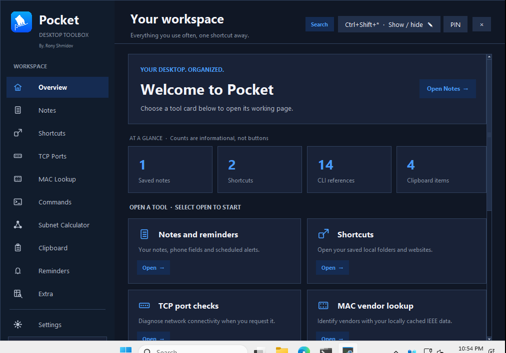

  <sub><strong>Pocket Dashboard · v1.40.0</strong> — captured in automated Windows GUI tests with sample data.</sub>
</div>

<p align="center">
  <a href="#features">Features</a> ·
  <a href="#screenshots">Screenshots</a> ·
  <a href="#whats-new-in-v1400">What's new</a> ·
  <a href="#installation">Installation</a> ·
  <a href="#privacy--connectivity">Privacy</a> ·
  <a href="#version-history">Changelog</a>
</p>

## Why Pocket?

Pocket keeps the small tools you reach for all day **in one tray application**. Open it when needed, choose Normal, Mini, Dashboard, or Extra Mini, and return to work. Window placement, theme, menu visibility, icon order, and your last tool are saved locally.

- **Local-first:** Notes, CLI references, subnet math, reminders, clipboard tools, backups, and offline Excel database lookups work without a constant internet connection.
- **Fast to reach:** Tray access, configurable global hotkey, quick search, draggable Mini icons, and optional nine-slot Numpad text shortcuts.
- **Built for real workflows:** TCP and MAC diagnostics, Excel record lookup, and optional unsent Outlook SOC drafts.
- **Opt in to remote checks:** DashDash is used only when you choose the remote source and run a check. Local tools never require a Pocket account.

## What's new in v1.40.0

Version **1.40.0** brings Excel/SQLite lookup, Outlook SOC drafts, and improved Mini navigation to the official Windows Portable and Standalone packages. [Read the v1.40.0 release notes](docs/releases/v1.40.0.md).

| Area | Improvements in the v1.40.0 source |
| :--- | :--- |
| **Extra · Excel lookup** | Read-only local workbook search or a manually created, offline SQLite index; compact match summaries, original-column details, keyboard navigation, and a dedicated result scrollbar in Mini. |
| **Outlook · SOC** | Prepare an **unsent** draft from the selected Excel result with line, VDOM, and available FortiGate details. Fill missing information and send manually. |
| **Excel shortcuts** | Reopen the exact already-open workbook instead of creating a duplicate where Windows/Office allows it; different workbooks remain open. |
| **Mini navigation** | Drag the actual toolbar icons to reorder, right-click to hide, and use a trailing Add (+) to bring tools back without losing their data. |
| **Settings · Show / Hide** | Compact controls below Appearance. **Green icon = active**, **red icon = hidden**; no duplicate menu-order editor. |

**[v1.40 technical notes](docs/SETTINGS_SHORTCUTS_V140.md)** · **[Excel/SQLite & SOC guide](docs/EXTRA_EXCEL_LOOKUP.md)** · **[Release acceptance checklist](docs/RELEASE_CHECKLIST_V140.md)** · [Experimental Windows preview (not stable)](https://github.com/Dovshmi/Pocket/releases/tag/extra-excel-preview-20261120)

> [!NOTE]
> Official v1.40.0 builds pass automated Windows/Linux checks. Real protected Excel/Outlook integration and permission for unencrypted local data storage still require **workstation-specific acceptance tests**. The old experimental preview is separate from the official stable release.

## Screenshots

**Real v1.40.0 Windows captures**, taken by the automated GUI smoke tests with a synthetic user profile. These are not mockups and do not contain customer workbooks or private commands. UI contents and window arrangements may vary by selected mode.

<div align="center">
<table>
<tr>
<td width="50%" align="center">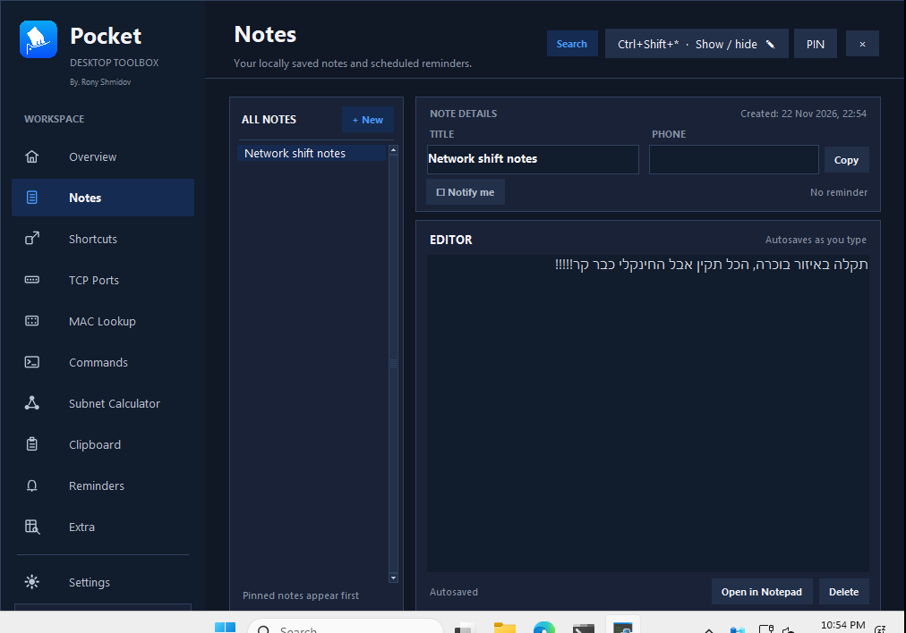<br /><strong>Notes</strong></td>
<td width="50%" align="center">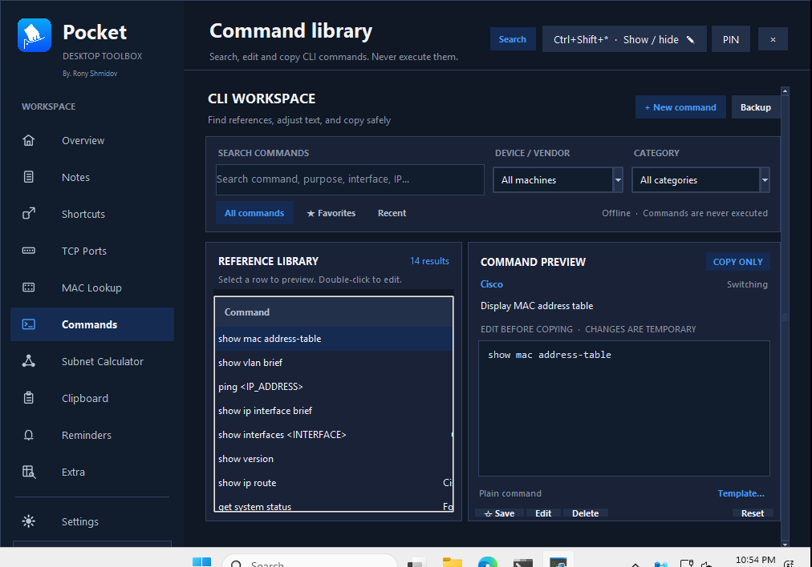<br /><strong>Command Helper</strong></td>
</tr>
<tr>
<td align="center">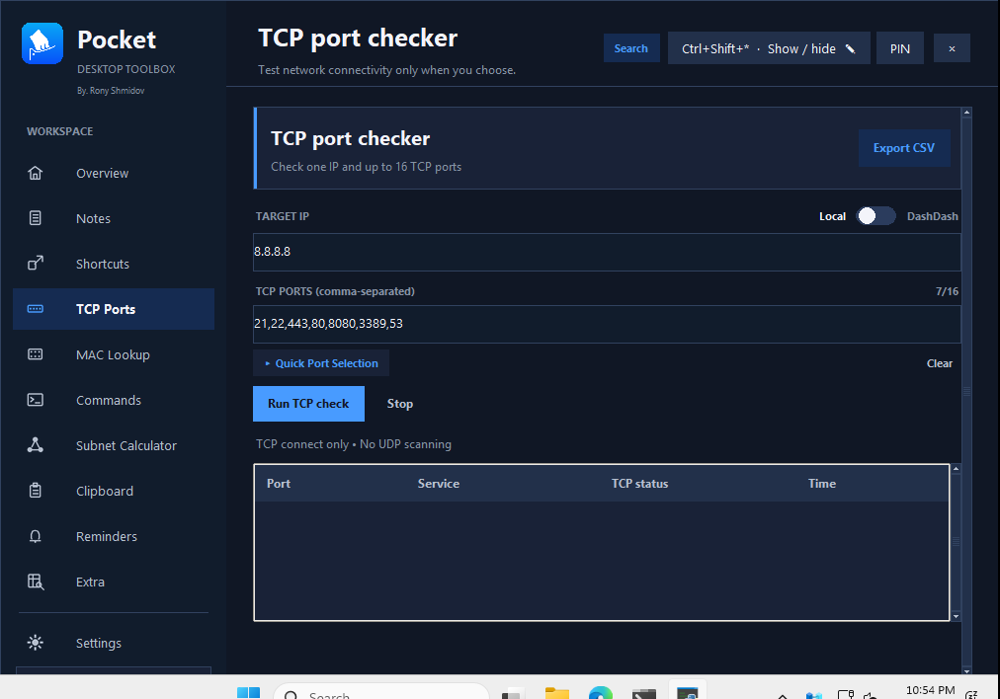<br /><strong>TCP Port Checker</strong></td>
<td align="center">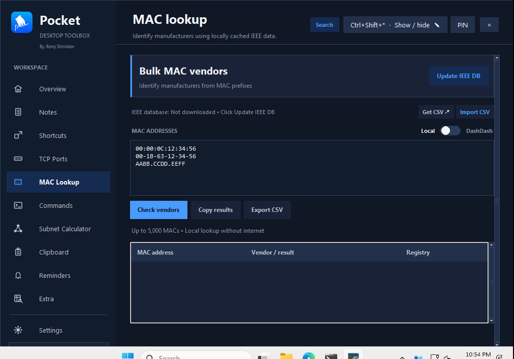<br /><strong>MAC Vendor Lookup</strong></td>
</tr>
<tr>
<td align="center">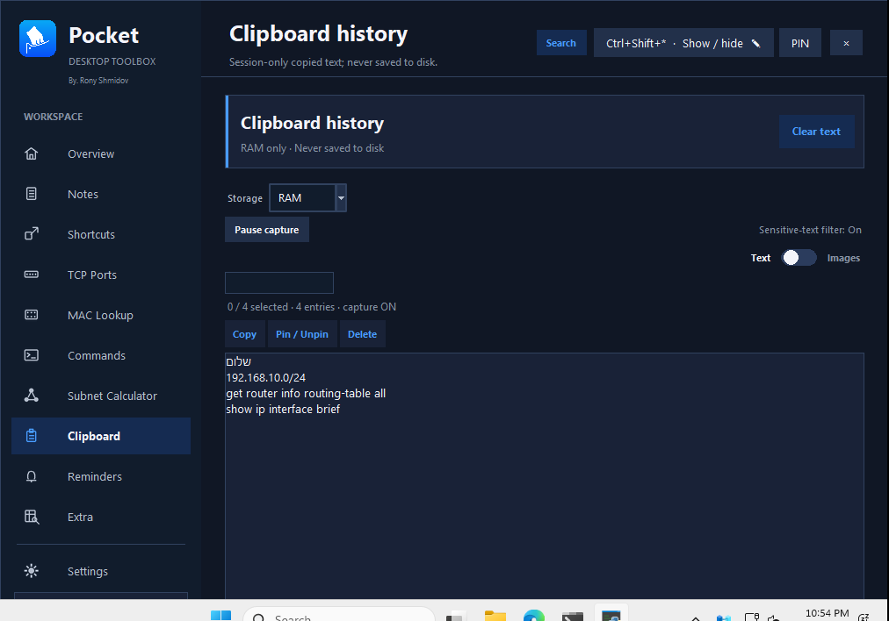<br /><strong>Clipboard Manager</strong></td>
<td align="center">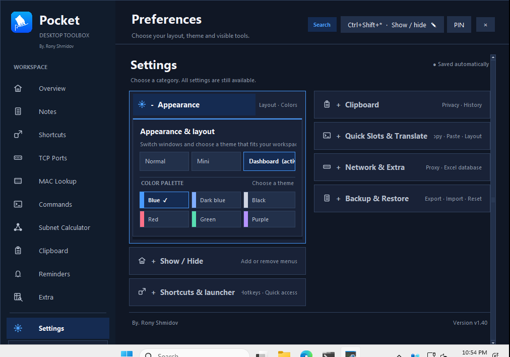<br /><strong>Settings</strong></td>
</tr>
</table>
</div>

<details>
<summary><strong>More screenshots — Mini, Shortcuts, Subnet & Extra Mini</strong></summary>

<br />

<div align="center">
<table>
<tr>
<td align="center">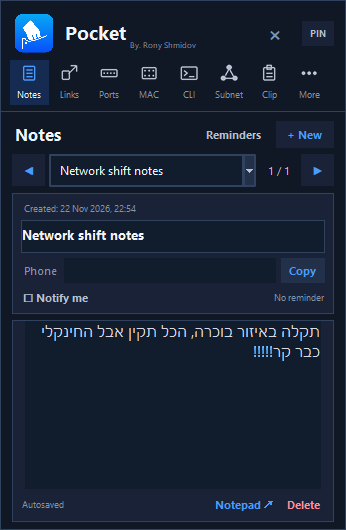<br /><strong>Mini Notes</strong></td>
<td align="center">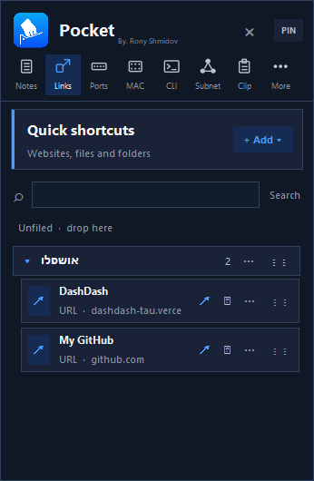<br /><strong>Mini Shortcuts</strong></td>
<td align="center">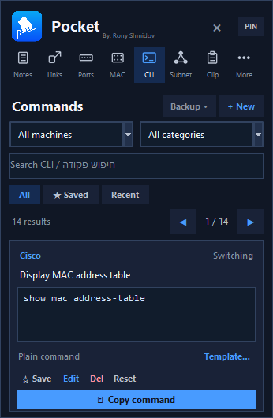<br /><strong>Mini Commands</strong></td>
</tr>
<tr>
<td align="center">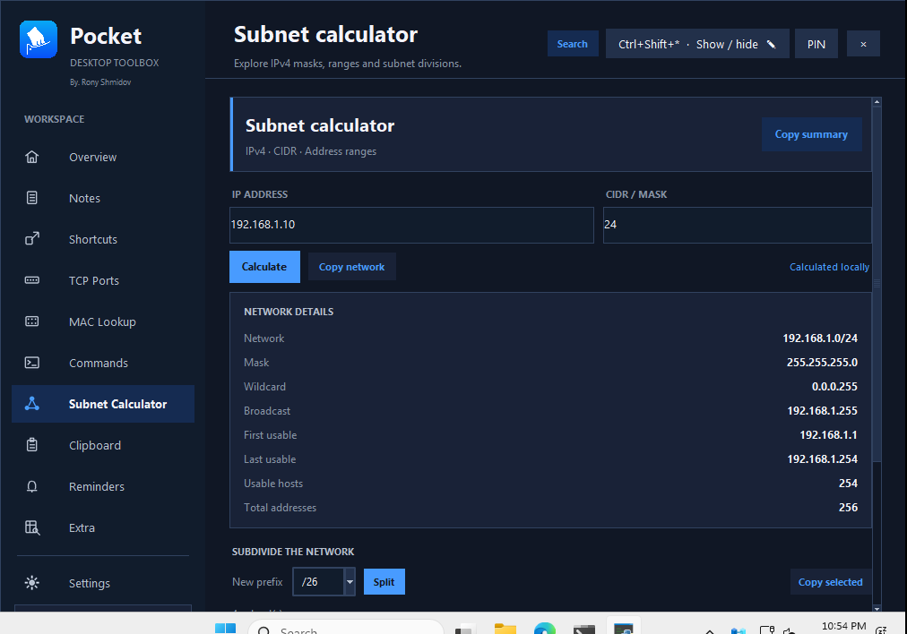<br /><strong>Subnet Calculator</strong></td>
<td align="center">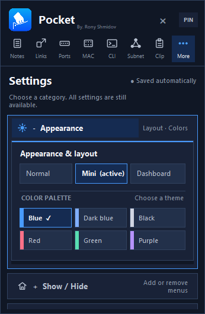<br /><strong>Mini Settings</strong></td>
<td align="center">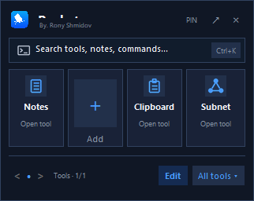<br /><strong>Extra Mini launcher</strong></td>
</tr>
</table>
</div>

</details>

<sub>Screenshot provenance: [v1.40.0 Windows CI run](https://github.com/Dovshmi/Pocket/actions/runs/45080242747). Older [v1.30 screenshots](docs/images/pocket-v130-real) remain available for historical comparison. The Excel/SQLite module is documented in its [feature guide](docs/EXTRA_EXCEL_LOOKUP.md); it is not shown in the gallery above.</sub>

## Features

| Tool | What you can do | Connection |
| :--- | :--- | :--- |
| **Notes** | Save title, phone, text, creation time, pinned notes; duplicate, search and open in Windows Notepad. | Offline |
| **Reminders** | Schedule stand-alone or Note-linked alerts, snooze, mark complete and retain responses locally. | Offline |
| **Commands Helper** | Search command references by device/category, use Smart Templates, edit and copy CLI; no command execution. | Offline |
| **Quick Shortcuts** | Organize URLs, files, folders and apps; drag/reorder; open Excel workbooks intelligently. | Only if opening web links |
| **TCP Port Checker** | Check up to 16 TCP ports, manage favorites, sort reachable results first, and export CSV. | Local or opt-in DashDash |
| **MAC Vendor Lookup** | Resolve from local IEEE data or request an optional remote lookup. | Local or opt-in DashDash |
| **Subnet Calculator** | Calculate IPv4 CIDR, masks, wildcard, host ranges, network and broadcast addresses. | Offline |
| **Clipboard Manager** | Keep text and image history, search, pin, manage retention and use nine Quick Slots. | Offline |
| **Extra · Excel** | Search authorized workbooks locally, optionally sync to SQLite, inspect a row and prepare an Outlook SOC draft. | Local / offline index |

### A few useful workflows

**Excel → matched customer → SOC draft.** In Extra, browse to an authorized workbook, search across worksheets, inspect the selected record and choose **Outlook · SOC**. Pocket prepares a draft only; it **never sends the email**. The database mode is independent of Excel once an index has been created and loaded.

**Selected text → Quick Slot → paste later.** Save text to one of nine numbered slots and insert it into another application using configurable Numpad shortcuts. Slot content is deliberately **excluded from portable backups**.

**CLI lookup → Smart Template → copy.** Filter by machine or category, fill supported placeholders such as `{{IP}}`, then copy the command. Pocket does not run network commands on your behalf.

**One window, several layouts.** Normal keeps the classic compact workflow; Mini sits beside other applications; Dashboard provides a wider overview; Extra Mini offers a customizable tile launcher. Choose any of six themes: Blue, Dark Blue, Black, Red, Green, or Purple.

Guides: [Quick Slots](docs/QUICK_SLOTS.md) · [Backup & Restore](docs/BACKUP_RESTORE.md) · [Excel & SOC](docs/EXTRA_EXCEL_LOOKUP.md) · [Windows proxy](docs/WINDOWS_PROXY.md)

## Installation

### Windows stable — v1.40.0

| Portable ZIP <sub>(recommended)</sub> | Standalone EXE |
| :--- | :--- |
| **[Pocket-Portable-v1.40.0.zip](https://github.com/Dovshmi/Pocket/releases/download/v1.40.0/Pocket-Portable-v1.40.0.zip)** | **[Pocket-v1.40.0.exe](https://github.com/Dovshmi/Pocket/releases/download/v1.40.0/Pocket-v1.40.0.exe)** |
| Extract the full archive, then run `Pocket-Portable/PocketDesk.exe`. Keep its `_internal/` folder beside it. | Run the single EXE directly. |
| Local data: `Pocket-Portable/data/`. | Local data: `%APPDATA%\PocketDesk\`. |

No Python installation is needed for either Windows binary. Both downloads are built from the official **v1.40.0** source. Verify them with [SHA-256 checksums](https://github.com/Dovshmi/Pocket/releases/download/v1.40.0/SHA256SUMS.txt). [v1.39.9](https://github.com/Dovshmi/Pocket/releases/tag/v1.39.9) remains available for rollback.

**Upgrading a portable installation:** fully exit Pocket (including the tray process), back up the old `data/` folder, extract the new ZIP into a **new** folder and copy only your user data across. Never mix `_internal/` folders from different versions. You can also use **Settings → Backup & Restore** to transfer selected data.

> [!IMPORTANT]
> Windows binaries are **not code-signed**. Use them on managed machines only when permitted by your organization. Do not bypass workplace application controls. See [workplace setup notes](docs/WORKPLACE_PORTABLE.md).

### Run from source

Tested in CI with Python **3.11 and 3.13**, on Windows and Linux (Windows-specific Office features require Windows).

```powershell
git clone https://github.com/Dovshmi/Pocket.git
cd Pocket
py -3 -m pip install -r requirements.txt
py -3 app.pyw
```

## Productivity shortcuts

| Action | Default |
| :--- | :--- |
| Show/hide Pocket | Tray icon or configurable global hotkey |
| Search enabled tools | `Ctrl+K` |
| Find within Commands | `Ctrl+F` |
| New Note | `Ctrl+N` |
| Save | `Ctrl+S` |
| Save selected/clipboard text to Quick Slot 1–9 | `Ctrl+Alt+Win+Numpad1–9` |
| Paste a saved Quick Slot | `Ctrl+Alt+Numpad1–9` |

Quick Slot shortcuts use **Num Lock ON**. Their modifier combinations and paste behavior can be configured in Settings. [Full Quick Slots reference](docs/QUICK_SLOTS.md).

## Privacy & connectivity

Pocket does not require an account, cloud sync, or permanent internet access. Most tools operate locally; **remote diagnostics are an explicit choice**.

| Feature | Local behavior / privacy notes |
| :--- | :--- |
| **Notes, reminders, shortcuts & settings** | Stored in the local Pocket profile (`data.json`). |
| **CLI library** | Custom commands are local. Public downloads include only sanitized example commands. |
| **Clipboard** | RAM-only history by default; optional local Text/Images DATABASE is opt-in and stores readable text/PNG files. |
| **Quick Slots** | Stored locally and **excluded** from portable backup exports. |
| **Excel Extra** | Local workbook read-only lookup. Offline SQLite is created/refreshed **only when Sync is pressed**. SQLite stores readable data and is **not encrypted**. |
| **Backup & Restore** | Manual, selective local ZIP backup; restore preview with Merge/Replace and safety snapshot. ZIP files are **not encrypted**. |
| **MAC vendor data** | Local IEEE cache unless an explicit remote lookup is requested. |
| **TCP checks** | Local checks run from your PC. Opt-in DashDash checks run **from Vercel**, not your workstation, and support public IPv4 targets. |

For authorized remote checks, Pocket can use the configured Windows proxy/PAC with HTTPS certificate checks intact. Switching a source does not silently run a network scan. Avoid submitting confidential customer/infrastructure targets to remote services.

> [!CAUTION]
> Pocket's offline Excel index, clipboard DATABASE, and backup ZIPs can contain **unencrypted local copies of sensitive information**. Only use these features with approved datasets and storage under your organization's policies. Do not commit workbooks, SQLite files, backups, passwords, or customer data to a public repository.

[Clipboard storage & retention](docs/CLIPBOARD_DATABASE.md) · [Proxy/PAC details](docs/WINDOWS_PROXY.md) · [Backup details](docs/BACKUP_RESTORE.md)

## Version history

| Version | Highlights | Distribution |
| :--- | :--- | :--- |
| **v1.40.0 — latest stable** | Extra Excel / SQLite lookup, Outlook SOC draft, smart Excel shortcut reuse, movable Mini menus, compact Show / Hide, improved scrolling. | **Official Windows ZIP / EXE** |
| **v1.39.9** | Stand-alone and Note-linked Reminders, snooze, response capture, compact Reminder navigation. | Previous stable release |
| **v1.39.1–v1.39.8** | Quick Slots paste, save, history preservation, settings and Windows notice refinements. | Previous stable releases |
| **v1.39.0** | Selective Backup & Restore, nine Quick Slots, shortcut recorder and Settings reset. | Previous stable release |
| **v1.38.0** | Clipboard DATABASE improvements, Notes/Notepad sync, keyboard-layout repair and proxy support. | Previous stable release |
| **v1.34–v1.37** | Native Windows input, foldered Shortcuts, screenshot history, better networking and UI controls. | Earlier releases |

All older releases are preserved. See **[full release notes](RELEASE_NOTES.md)**, [individual release notes](docs/releases), and [GitHub Releases](https://github.com/Dovshmi/Pocket/releases).

## Development & contributing

**Stack:** Python, Tkinter/ttk, Windows APIs and Office COM integration, Pillow, `tkinterdnd2`, optional `openpyxl`/`xlrd` Excel readers, SQLite and PyInstaller.

```powershell
# Run unit tests
py -3 -m unittest discover -s tests -p "test_*.py" -v

# Build the Windows distributions
.\build-portable.bat
.\build-exe.bat
```

GitHub Actions runs Windows/Linux unit and GUI checks and Windows portable runtime smoke tests. Synthetic data is used for automated UI screenshots; protected enterprise Excel, Outlook and local data-policy acceptance must be tested separately on authorized workstations.

[Repository structure](docs/REPOSITORY_LAYOUT.md) · [Open an issue](https://github.com/Dovshmi/Pocket/issues) · [Release readiness for v1.40](docs/RELEASE_CHECKLIST_V140.md)

---

<div align="center">

**Pocket — small tools, one workspace.**

Made by Rony Shmidov · [GPL-3.0](LICENSE) · Windows 10/11

</div>
