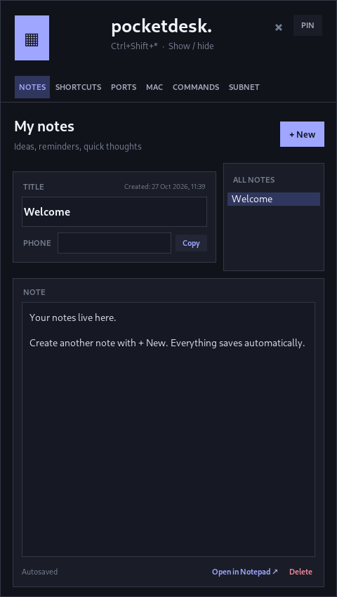
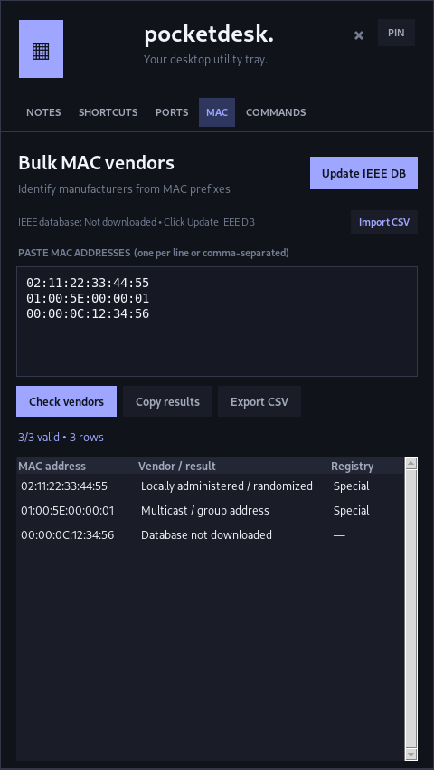
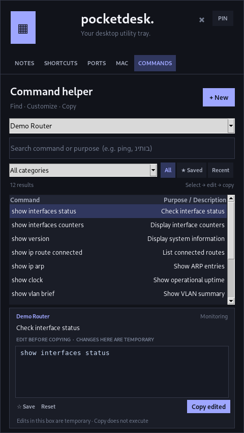
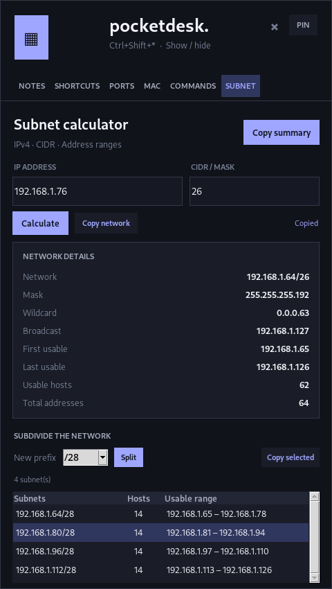

<div align="center">

# Pocket

**Your everyday tools, one shortcut away.**

A compact, local-first Windows tray toolbox for notes and reminders, clipboard history, shortcuts, network diagnostics, CLI references, and subnet planning.

**Windows 10 / 11** · **Python 3.10+** · **v1.26 (development branch)** · **Local-first** · **GPL-3.0**

[Features](#features) · [App gallery](#app-gallery) · [Installation](#getting-started) · [Build an EXE](#building-a-windows-executable) · [Changelog](#version-history)

</div>

<p align="center">
  <a href="preview-window-position.png"></a>
</p>

> [!NOTE]
> **Project status:** Pocket is actively developed. This repository contains source code, not a prebuilt Windows release. Screenshots below are real captures of **earlier builds**; some controls and tabs differ from the current v1.25 interface.


## What is Pocket?

Pocket is designed for tasks that are too small to justify opening another full-size app: jotting down a phone number, launching a frequently used folder, checking a TCP port, identifying a MAC vendor, finding a CLI command or calculating a subnet.

It stays out of the way until you need it, and stores your personal notes and preferences **on your own computer**.

## App gallery

Pocket has seven tool menus plus Settings in a compact movable window. The screenshots below are authentic captures from earlier versions; the current version also includes **Clipboard**, **Settings**, and **per-note reminders**.

<table>
  <tr>
    <td align="center" width="33%"><a href="preview-notes-pinned-v117.png"></a><br><strong>Notes</strong><br><sub>Autosave, pin and organize</sub></td>
    <td align="center" width="33%"><a href="preview-shortcuts-fixed.png"></a><br><strong>Shortcuts</strong><br><sub>Sites, files and folders</sub></td>
    <td align="center" width="33%"><a href="preview-ports.png"></a><br><strong>TCP Ports</strong><br><sub>Fast connectivity checks</sub></td>
  </tr>
  <tr>
    <td align="center"><a href="preview-mac.png"></a><br><strong>MAC Lookup</strong><br><sub>IEEE OUI identification</sub></td>
    <td align="center"><a href="preview-commands-layout.png"></a><br><strong>Commands</strong><br><sub>Search, edit and copy</sub></td>
    <td align="center"><a href="preview-subnet-v117.png"></a><br><strong>Subnet Calculator</strong><br><sub>CIDR and network splits</sub></td>
  </tr>
</table>

Additional detail captures: [Notes actions](preview-note-context-menu.png) · [Shortcut drag-and-drop](preview-shortcuts-drop.png) · [Command editor](preview-commands-edit.png) · [Saved window position](preview-window-position.png).

## Features

### Seven tools in one window

| Tool | Capabilities |
|:---|:---|
| **Notes & reminders** | Autosaved notes with titles, phone fields and creation dates. Pin, duplicate, delete, use right-click text actions, select per-note RTL/LTR direction (Windows native Unicode editor for Hebrew notes), insert timestamps, or edit in Notepad with saved changes imported into Pocket. Enable **Notify me…** on an individual note to schedule a one-time Windows notification. Selected IPs and CLI text can be sent to their respective tools. |
| **Shortcuts** | Save and open websites, local files and folders. Add shortcuts manually or by dragging items from your browser/File Explorer into a review form. The **compact live search** filters saved shortcuts by name, destination and type. Each shortcut card has direct **Open**, **Copy**, and overflow-menu actions. |
| **TCP Ports** | Test one TCP port, predefined ports, or a custom list/range against an IPv4 or IPv6 address. See **OPEN**, **CLOSED**, **TIMEOUT** and **ERROR** results, with copy/export options. |
| **MAC Lookup** | Look up hardware vendors using IEEE OUI prefix assignments. Supports multiple MAC addresses, downloading/importing registry data, offline lookup after caching, and CSV export. |
| **Commands** | Search a network CLI library by device, category, syntax or purpose (including Hebrew). Edit before copying; favorite, add, edit and delete saved entries. Uses one writable `commands.json` with manual backup and restore. **Commands are never executed.** |
| **Subnet Calculator** | IPv4 CIDR/netmask calculations: network and broadcast, wildcard mask, first/last usable address, usable/total address counts, and subdivision into smaller networks. Includes `/31` and `/32` handling. |
| **Clipboard** | Searchable, session-only history of copied **text**. Pin entries, copy an item back to Windows, or delete/clear history. Monitoring automatically runs while Clipboard is visible in Settings; captured text is **not persisted**. |

### Personalize the workspace

**Settings (⚙)** shows or hides tool menus without deleting their underlying saved data. When **Clipboard** is included in the visible menus, Pocket monitors new copied text while running—even when its window is hidden in the tray. Hide Clipboard to stop monitoring; there is **no second enable/disable switch**. Additional visible tools are accessible under **MORE**.

| Feature | How it works |
|:---|:---|
| **Six color themes** | Click the **pocket logo** to choose Blue, Dark Blue, Black, Red, Green or Purple. Pocket updates the window colors, in-app logo and tray icon, then remembers your choice. |
| **Your own popup shortcut** | Click the shortcut label directly beneath **Pocket** to select Ctrl/Alt/Shift/Win modifiers and a key. Default: **Ctrl + Shift + \***. If Windows cannot register a new combination, the previous working shortcut is retained. |
| **Move and remember** | Drag the header to move the popup. The position is saved and restored. Right-click the header → **Reset window position**. |
| **PIN mode** | Keep Pocket visible when you switch to another app — useful for copying information and dragging shortcuts. |
| **System tray** | Click the tray icon to show/hide Pocket. The close button hides the popup; it doesn't erase your notes. |
| **Scheduled note reminders** | On an individual note, choose **Notify me…**, set a local date and time, and receive a Windows tray notification. Clicking the notification is designed to reopen that note. Overdue, unsent reminders are checked on the next launch. |
| **Menu visibility** | Show/hide individual tool tabs under Settings, without removing any saved data. |

**Note on icons:** The live window and system-tray icons change with your selected theme. The compiled EXE retains its **blue embedded icon**, and Windows can cache desktop/taskbar shortcut artwork.

### Scheduling a note reminder

1. Open **Notes** and select the note you want.
2. Check **Notify me** next to the note details, or right-click the note in the list and choose **Notify me…**.
3. Enter the **date** as `YYYY-MM-DD` and the **time** as `HH:MM` (24-hour, using your computer's local time); choose **Save reminder**.
4. Keep Pocket running in the Windows system tray. At the scheduled time, Pocket sends a Windows notification with the note title and a short text preview.

Uncheck **Notify me** to cancel the reminder. To reschedule, select the reminder's date/time or use **Change notification time…** in the note menu. Reminders are one-shot and their delivery state is stored in `data.json` to avoid repeatedly notifying after a restart.

> **Limitations:** Pocket does not register a system-level background alarm. It must be running to deliver a notification on time; if closed, it checks overdue reminders when restarted. Notifications use Windows tray balloon APIs rather than a full Windows App SDK toast integration. Appearance, click behavior, and delivery depend on Windows notification settings and should be tested on Windows.

### Clipboard behavior and privacy

- **Show Clipboard in Settings** → Pocket starts recording newly copied text, including while minimized to the system tray.
- **Hide Clipboard in Settings** → Pocket stops collecting new entries. Hiding the tab does **not** clear the current in-memory list.
- Clipboard history is **session-only**: it is not written to `data.json` and disappears when Pocket exits. Text copied before Pocket starts is not recovered from Windows clipboard history.
- Copying passwords, API keys, or other sensitive text can cause them to appear in clipboard history during that session. Use **Clear all** and hide Clipboard when appropriate. Pocket does not automatically identify secret content.


## Getting started

### Requirements

- **Windows 10 or 11** (tray integration and global popup shortcuts use native Windows APIs).
- **Python 3.10 or newer**, installed with Tkinter and the Windows Python launcher (`py`).
- Internet access for first-time dependency installation and optional IEEE vendor-database updates.

### Run from source

**Option A — download a ZIP:** [Download the latest source](https://github.com/Dovshmi/Pocket/archive/refs/heads/main.zip), extract it, and open the extracted folder.

**Option B — clone the repository:**

```powershell
git clone https://github.com/Dovshmi/Pocket.git
cd Pocket
```

Then:

1. Double-click **`install.bat`** to install the Python dependencies (including Pillow for the themed icons).
2. Double-click **`run.bat`** to launch Pocket.
3. Find the Pocket icon in the notification area, near the Windows clock. If hidden, click the **^** overflow arrow.
4. Click the tray icon or use **Ctrl + Shift + \*** to toggle the popup.

You can also install and launch manually:

```powershell
py -3 -m pip install -r requirements.txt
py -3 app.pyw
```

> **Why run `install.bat` first?** `run.bat` contains a first-run check for drag-and-drop support, but that check alone may not install the newer **Pillow** dependency on an existing setup. Running `install.bat` installs all declared dependencies.

### First things to try

1. Open **Notes**, create a note and try **Notify me…** to schedule a reminder.
2. Open **Settings (⚙)** and choose which menus appear. Add or hide **Clipboard** to start or stop text monitoring.
3. Open **Shortcuts** and add a website or folder, then try the live search.
4. Click the **pocket logo** to change themes, or click the shortcut label under Pocket to customize the global hotkey.
5. Open **Subnet** and calculate `192.168.1.10/24`, or use **Commands → Backup ▾** to save a manual command-library backup.

## Building a Windows executable

To build a standalone executable on **Windows**, run:

```bat
build-exe.bat
```

The script installs build requirements, generates the blue embedded icon, and uses PyInstaller to produce:

```text
dist\PocketDesk.exe
```

The generated executable name remains **PocketDesk.exe**, while the window header says **Pocket**.

> [!WARNING]
> **Do not publish an EXE built with a private command library.** The build script uses `commands/commands.json` if it exists locally, which can bundle that file inside the executable. Build public artifacts without a private `commands/commands.json`. No prebuilt EXE is included in this repository.

**Packaging caveat:** Native Windows tray interaction, hotkey registration, icon refresh and multi-monitor behavior should be tested on a Windows machine before distributing a build. Passing headless tests alone does not validate those integrations.

## Files, settings and privacy

Pocket saves user data under:

```text
%APPDATA%\PocketDesk\
├── data.json            # Notes/reminders, shortcuts, theme, hotkey, window position, menu preferences
├── vendors.json         # Cached or imported IEEE vendor data
├── icons\               # Locally generated color icon variants (PNG / ICO)
├── notepad_exports\     # Older, one-off .txt snapshots of notes
└── notepad\             # Stable working .txt files for Notepad synchronization
```

- **Local-first:** no account, hosted database or synchronization service is required.
- **Not encrypted:** notes, scheduled reminders, phone numbers and command libraries are stored as **plain-text JSON**. Do not store passwords or private keys there.
- **Clipboard history:** text is held in memory only and is cleared when Pocket exits. Turning off the Clipboard menu stops future capture, not the Windows system clipboard itself.
- **Notepad synchronization (v1.26 branch):** **Open in Notepad** opens a stable local working file. Saving in Notepad updates the Pocket note while Pocket is running (checked approximately every 1.2 seconds). If both editors changed the note, Pocket prompts before replacing content, and preserves a recovery copy when the Pocket version is selected. Older one-off exports remain separate and are not synchronized.
- **Network activity:** TCP checks contact only the specified target. Registry downloads retrieve IEEE vendor data when requested. Pocket doesn't send notes to a lookup service.
- **Authorization:** only scan systems you own or are authorized to test. A port timeout does not prove a port is closed.
- **MAC limitations:** an OUI indicates a registered vendor prefix, not proof of the exact device manufacturer or owner.

### CLI command library

The Commands tab uses **one writable JSON library**: `commands/commands.json`. Commands may be searched by machine and category, edited, copied, favorited, or deleted. Edits are saved atomically. **No automatic backup is created on save, edit, delete, or migration.** To make a backup, open **Commands → Backup ▾ → Create new backup**; use **Use existing backup** to choose a previously saved JSON file. Restoring replaces the active command library, so make a manual backup first if you need to preserve current changes. See [the example format](commands/example_commands.json).

> [!WARNING]
> **Public-repository review needed:** A command library is currently checked into this public repository, including a second copy at `Pocket_Commands_One_Library/commands/commands.json`. Review both copies for internal device names, infrastructure details, or other sensitive material before sharing. The `.gitignore` rule does **not** retroactively remove committed files. Do not commit secrets or workplace-only command collections.

The local application does not upload command edits automatically; GitHub publishing is a separate action.

> **Packaging caution:** Review the source library before building an EXE: a local `commands/commands.json` may be bundled inside it. Do not distribute a build containing private commands.

## Project structure

```text
Pocket/
├── app.pyw                 # Desktop UI, notes, tabs and tray
├── note_sync.py            # Notepad working-file sync and conflict backups
├── native_bidi.py          # Windows native right-to-left note editor
├── icon_themes.py          # Theme palettes and generated icons
├── hotkey_settings.py      # Configurable popup shortcut
├── command_helper.py       # Command search and editing
├── command_store.py        # Atomic command saves and manual backup/restore
├── machine_catalog.py      # Machine category support
├── network_tools.py        # Port tests and MAC lookup
├── subnet_calculator.py    # IPv4 calculations
├── shortcut_utils.py       # Shortcut handling
├── shortcut_drop.py        # Drag-and-drop support
├── commands/
│   ├── commands.json           # Currently tracked command data; review before sharing
│   ├── example_commands.json   # Example format
│   └── README.md
├── install.bat / run.bat   # Set up and launch
├── build-exe.bat           # Package a Windows executable
├── test_*.py               # Unit tests
└── smoke_*.py              # Optional GUI smoke checks
```

**Stack:** Python, Tkinter/ttk, Win32 APIs via `ctypes`, Pillow, `tkinterdnd2` and PyInstaller.

## Version history

> **Development:** v1.26 changes live on `feature/v1.26-notes-shortcuts`, not `main`. Mini Mode is planned for a later phase and will be controlled from Settings (not a header button).

Development milestones shown below are drawn from repository commits and feature implementations; they are **not** a claim that each intermediate version has a separate downloadable GitHub Release.

| Version | Date | Highlights |
|:---|:---|:---|
| **v1.26 (branch)** | 2026-10-29 | Native Windows bidirectional editing for Hebrew notes, Notepad save-to-Pocket synchronization with conflict handling, and direct Copy buttons for shortcuts. |
| **v1.25** | 2026-10-28 | Clipboard capture now follows menu visibility (no separate toggle). Added per-note one-shot reminders with local date/time scheduling, persistent delivery state and Windows tray notification handling. |
| **v1.24** | 2026-10-28 | Added Clipboard history, Settings, menu visibility controls, tray notification support and manual-only Commands backup/restore. |
| **v1.23** | 2026-10-28 | Consolidated commands into a single writable local `commands.json` library, with optional machine names stored in the same file. |
| **v1.22** | 2026-10-28 | Full machine catalogue (32 named categories), 32 additional read-only CLI examples, and merged public/private/custom references. |
| **v1.21** | 2026-10-28 | Expanded public network CLI catalogue to 118 entries; fixed dependency detection, empty TCP scan and private command-file fallback. |
| **v1.20** | 2026-10-28 | App header renamed to **Pocket**, clickable configurable global hotkey, compact live Shortcuts search. |
| **v1.19** | 2026-10-28 | Six saved themes and matching live app/tray icons. |
| **v1.18** | 2026-10-27 | Movable popup with persistent positioning and reset action. |
| **v1.17** | 2026-10-27 | Subnet calculator and note pin/duplicate/delete actions; integrated into the v1.18 commit. |
| **v1.16** | 2026-10-27 | Full-width note editor, expanded context actions, shortcut-layout fixes. |
| **v1.10** | 2026-10-27 | Unified tall layout and multiline command editing. |
| **v1.6** | 2026-10-26 | Initial functional tray toolbox with notes, shortcuts and network tools. |

View the complete [commit history](https://github.com/Dovshmi/Pocket/commits/main).

## Testing and development

After installing dependencies, run all discoverable unit tests:

```powershell
py -3 -m unittest discover -v
```

The project includes tests for data storage and migration, theme settings, generated icons, configurable hotkeys, shortcut filtering, subnets, command management, clipboard preferences, reminder scheduling, note actions and network utilities.

GUI smoke scripts are provided separately (see `smoke_*.py`) and need a functioning display. **The repository does not currently claim a verified Windows CI release pipeline.** The new command coverage tests are source-level checks, not proof that every command works on every vendor model and firmware.

## Contributing and feedback

Bug reports, ideas and pull requests are welcome.

- [Open an issue](https://github.com/Dovshmi/Pocket/issues) with reproduction steps, Windows/Python versions, and relevant error details (remove private information from screenshots/logs).
- For code changes, keep features focused and add or update tests when applicable.
- Run `py -3 -m unittest discover -v` before proposing a pull request.
- Never upload local `data.json`, passwords, or private command packs. Review the command data already tracked in the repository.

## License

Licensed under the [GNU General Public License v3.0](LICENSE).

---

<div align="center">

**Pocket** — a small toolbox for the things you do all day.

[Back to top](#pocket)

</div>
